# {.dark}
:::{style="font-size: 3em; display: inline-block; width: 15%;"}
<h1 class="ucl-light-purple">1</h1>
:::
:::{style="display: inline-block; width: 80%;"}
<h2>Imagination<br>and causal judgment</h2>
:::

:::{.ucl-pale-purple .tiny}
Krasich, K., O’Neill, K., & De Brigard, F. (2024).<br>&emsp;&emsp;Looking at mental images: Eye‐tracking mental simulation during retrospective causal judgment.<br>&emsp;&emsp;*Cognitive Science.*

Henne, P., & O'Neill, K. (2022).<br>&emsp;&emsp;Double prevention, causal judgments, and counterfactuals. *Cognitive science.*

O'Neill, K., Henne, P., Quillien, T., Icard, T., & De Brigard, F. (2025).<br>&emsp;&emsp;Norms moderate causal judgments in cases of double prevention.<br>&emsp;&emsp;In *Proceedings of the Annual Meeting of the Cognitive Science Society.*

Quillien, T., O’Neill, K., & Henne, P. (2025).<br>&emsp;&emsp;A counterfactual explanation for recency effects in double prevention scenarios.<br>&emsp;&emsp;Commentary on Thanawala and Erb (2024). *Cognition.*
:::


## Can we find concrete evidence of counterfactual thinking?

:::{.columns}

::::{.column width="50%"}
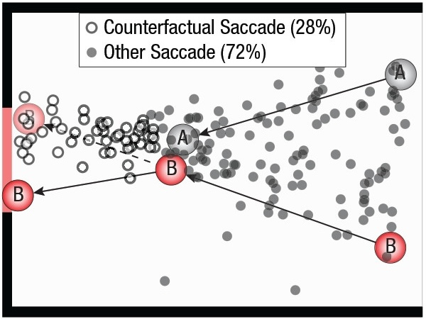{width="100%" .fragment fragment-index=1}
::::

::::{.column width="50%"}

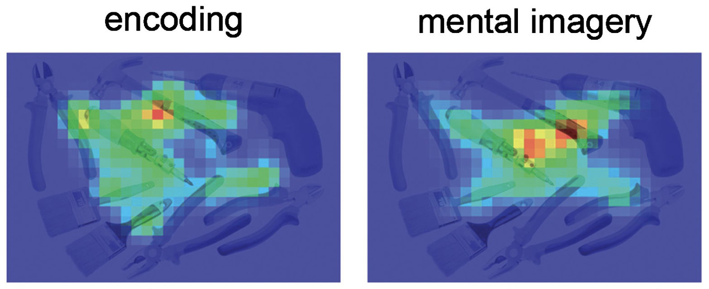{width="100%" .fragment fragment-index=3}

{.absolute width=230 top=210 left=539 style="outline: 5px white solid;" .fragment .fade-in-then-out fragment-index=2}


:::::{.ucl-white-bg .fragment .fade-out fragment-index=4 .absolute style="width: 240px; height: 225px; right: 25px; top: 175px;"}
:::::


[Do eye movements reflect counterfactual thought during *retrospective* causal judgment?]{.fragment fragment-index=5}
::::
:::


## Methods


```{=html}
<br><br>
<video controls muted width=500>
  <source src="_images/_eye_tracking/right_miss.mp4" type="video/mp4">
</video>
<video controls muted width=500>
  <source src="_images/_eye_tracking/right_score.mp4" type="video/mp4">
</video>
```


## Methods

:::{.r-stack}
{.center-xy width=1000}

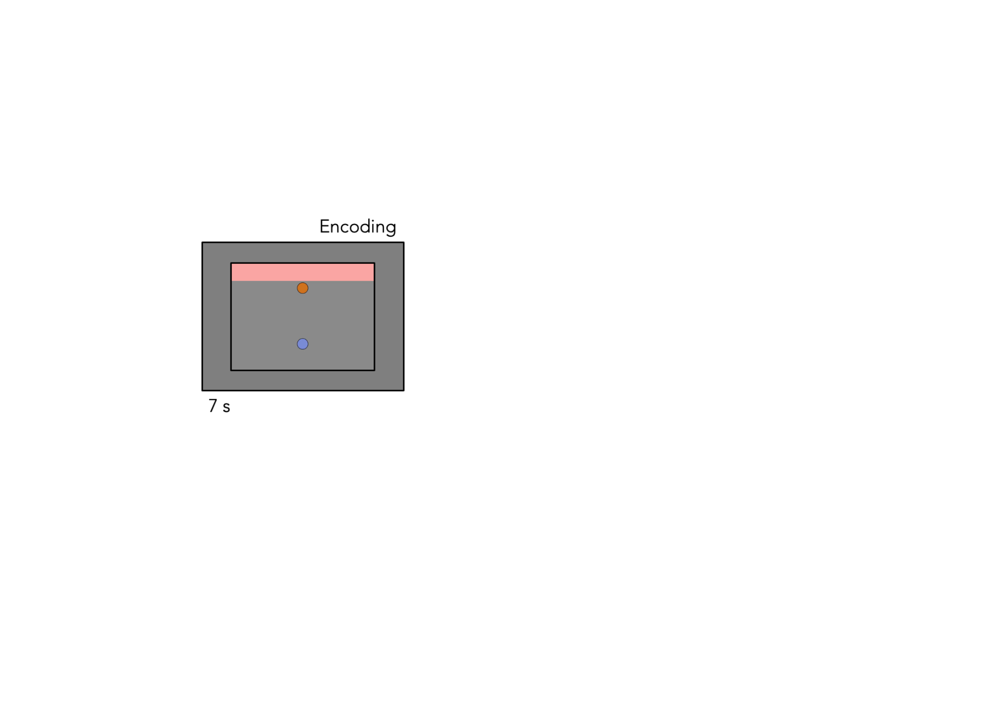{.center-xy width=1000 .fragment}

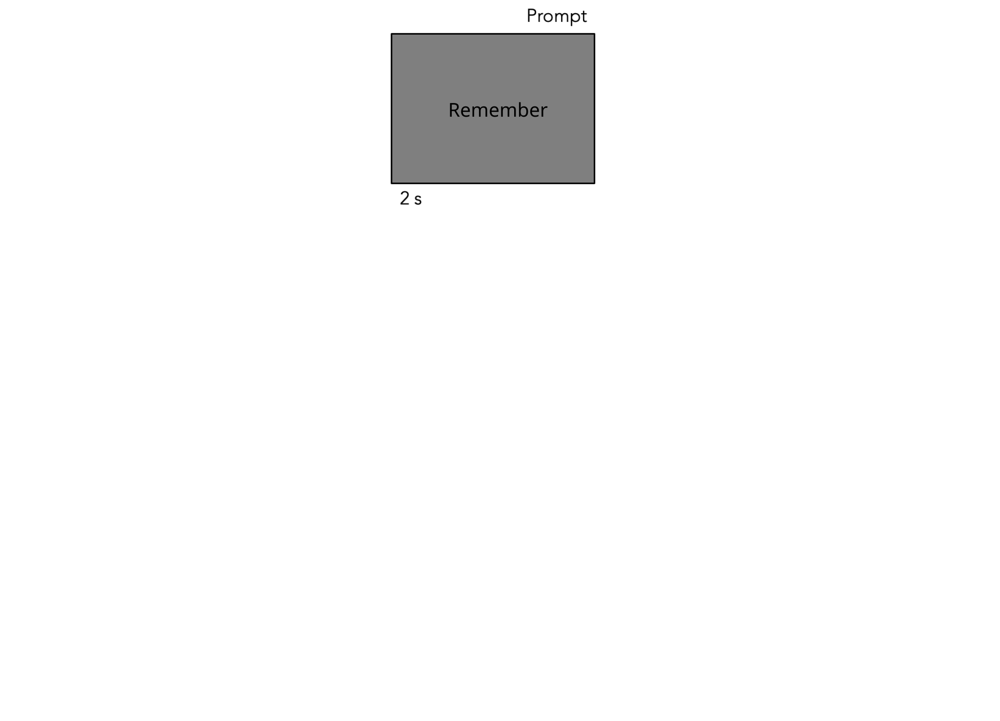{.center-xy width=1000 .fragment}

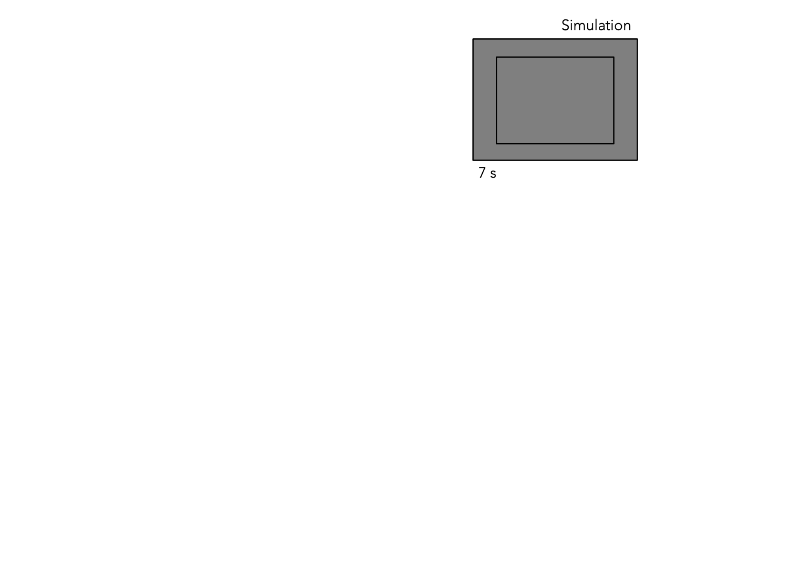{.center-xy width=1000 .fragment}

{.center-xy width=1000 .fragment}

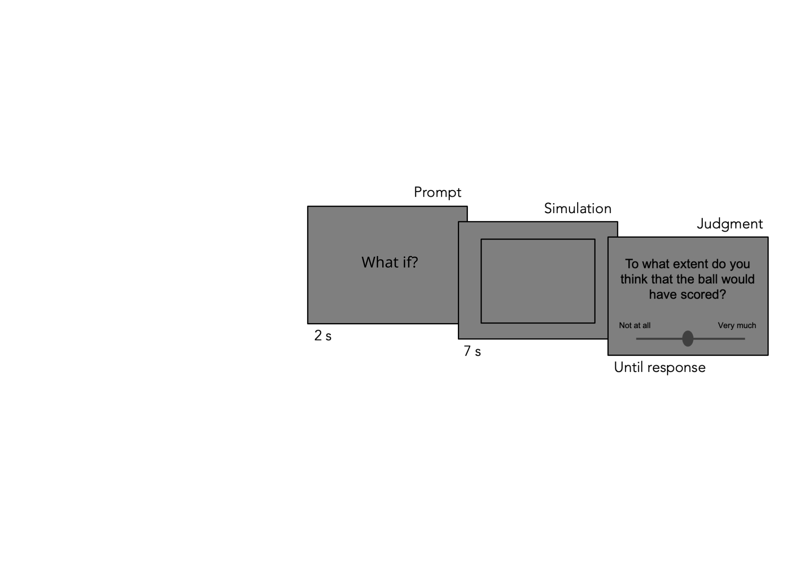{.center-xy width=1000 .fragment}

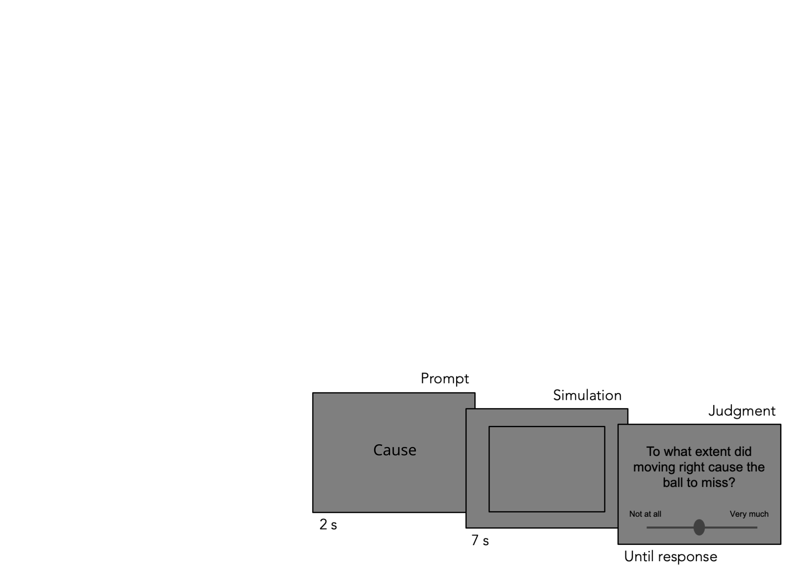{.center-xy width=1000 .fragment}
:::


## Hypotheses

:::{.notes}
* process theories vs dependence theories
:::


## Eye movements reveal counterfactual thinking

:::{style="width: 1100px"}
{width="100%"}
:::

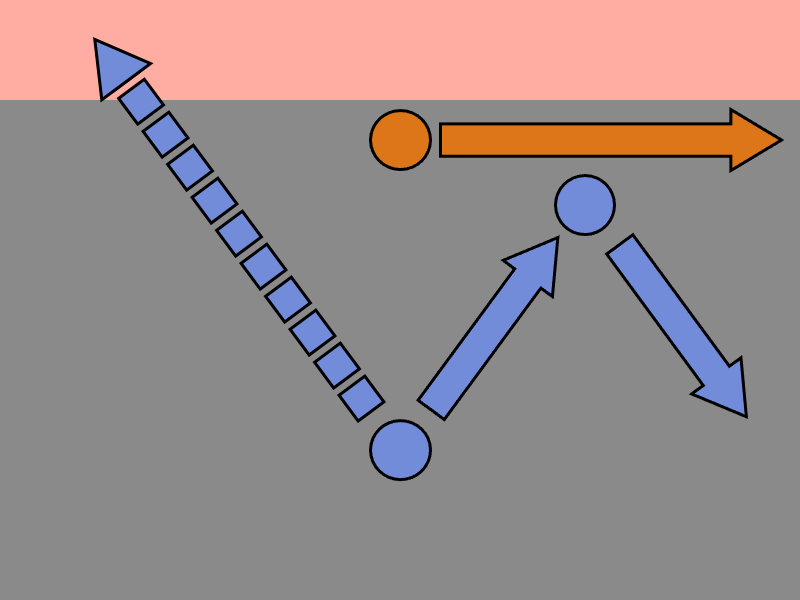{.absolute  .fragment .fade-out fragment-index=2 style="width: 217px; height: 163px; left: 34px; top: 198px;"}

:::{.fragment .fade-out fragment-index=6}
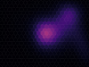{.absolute .fragment fragment-index=4 style="width: 216px; height: 163px; left: 35px; top: 198px;"}

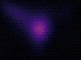{.absolute .fragment fragment-index=4 style="width: 216px; height: 163px; left: 261px; top: 198px;"}
:::


:::{.ucl-white-bg .fragment .fade-out fragment-index=1 .absolute style="width: 254px; height: 200px; left: 0px; top: 175px;"}
:::

:::{.ucl-white-bg .fragment .fade-out fragment-index=3 .absolute style="width: 219px; height: 200px; left: 260px; top: 175px;"}
:::

:::{.ucl-white-bg .fragment .fade-out fragment-index=7 .absolute style="width: 219px; height: 200px; left: 486px; top: 175px;"}
:::


:::{.ucl-white-bg .fragment .fade-out fragment-index=5 .absolute style="width: 254px; height: 200px; left: 0px; top: 382px;"}
:::

:::{.ucl-white-bg .fragment .fade-out fragment-index=8 .absolute style="width: 219px; height: 200px; left: 260px; top: 382px;"}
:::

:::{.ucl-white-bg .fragment .fade-out fragment-index=9 .absolute style="width: 219px; height: 200px; left: 486px; top: 382px;"}
:::


:::{.ucl-white-bg .fragment .fade-out fragment-index=5 .absolute style="width: 325px; height: 300px; right: 0px; top: 250px;"}
:::


## Eye movements reveal counterfactual thinking

:::{style="width: 1100px"}
{width="100%"}
:::

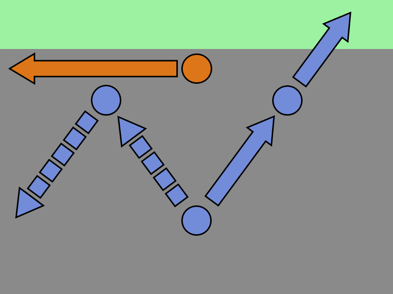{.absolute  .fragment .fade-out fragment-index=1 style="width: 217px; height: 163px; left: 34px; top: 198px;"}


:::{.ucl-white-bg .fragment .fade-out fragment-index=2 .absolute style="width: 219px; height: 200px; left: 260px; top: 175px;"}
:::

:::{.ucl-white-bg .fragment .fade-out fragment-index=3 .absolute style="width: 219px; height: 200px; left: 486px; top: 175px;"}
:::


:::{.ucl-white-bg .fragment .fade-out fragment-index=2 .absolute style="width: 254px; height: 200px; left: 0px; top: 382px;"}
:::

:::{.ucl-white-bg .fragment .fade-out fragment-index=5 .absolute style="width: 219px; height: 200px; left: 260px; top: 382px;"}
:::

:::{.ucl-white-bg .fragment .fade-out fragment-index=6 .absolute style="width: 219px; height: 200px; left: 486px; top: 382px;"}
:::


:::{.ucl-white-bg .fragment .fade-out fragment-index=3 .absolute style="width: 325px; height: 300px; right: 0px; top: 250px;"}
:::


```{r}
#| label: dp-libraries
#| include: false
#| cache: false

library(rstan)

```

```{r}
#| label: dp-setup
#| include: false

options(mc.cores=parallel::detectCores())

DP_PALETTE <- c("#C0C0C0", "#000000", "#E61C38")

## read in the data and normalize ratings to [0, 1]
judgments <- read_csv('_data/double_prevention.csv') |>
    mutate(Condition=factor(Condition, levels=c('C', 'DP'), labels=c('Control', 'Manipulation')),
           CFT_P=(CFT_P+50)/100,
           CFT_DP=(CFT_DP+50)/100,
           C_P=(C_P+50)/100,
           C_DP=(C_DP+50)/100)

## format data for Stan
dp.stan <- list(
  N=nrow(judgments),
  C=length(levels(judgments$Condition)),
  cause_PC=judgments$C_P,
  cause_DP=judgments$C_DP,
  condition=as.integer(judgments$Condition)
)


ns <- NULL
if (file.exists('_models/necessity-sufficiency.rds')) {
  ns <- readRDS('_models/necessity-sufficiency.rds')
} else {
  ns <- stan(
    '_models/necessity-sufficiency.stan',
    data=c(dp.stan, list(prior_only=0)), iter=11000, warmup=1000
  )
}

draws.post <- ns |>
  spread_draws(
    p_PC, p_PP, p_DP[COND],
    N_PC[COND], S_PC[COND], K_PC[COND], 
    N_DP[COND], S_DP[COND], K_DP[COND]
  ) |>
  relocate(.chain, .iteration, .draw, COND) |>
  pivot_longer(p_PC:K_DP, names_to=c('measure', 'variable'),
    names_sep='_', values_to='.value', values_drop_na=TRUE) |>
  mutate(
    COND=levels(judgments$Condition)[COND],
    measure=factor(
      measure, levels=c('p', 'N', 'S', 'K'),
      labels=c('Probability of Imagining the Counterfactual', 'Necessity', 'Sufficiency', 'Causal Judgment')
    ),
    variable=factor(variable, levels=c('DP', 'PP', 'PC'),
      labels=c('Double\nPreventer', 'Possible\nPreventer', 'Productive\nFactor')),
    .value=ifelse(measure=='Probability of Imagining the Counterfactual', 1-.value, .value)
  ) |>
  group_by(COND, measure, variable)
```


##

:::{.ucl-light-green-bg .absolute top=18 left=19 width=250 height=250 .fragment fragment-index=6}
:::

:::{.r-stack}
::::{.fragment fragment-index=1}
```{.tikz width=1000}
%%| filename: dp_1
\include{tikz_header.tex}
\begin{tikzpicture}
    \node[image] (PF) [] { \includegraphics[width=1cm]{_images/_double_prevention/ethan.jpg} };
    \node[image, hidden] (O) [right=2cm of PF] { \includegraphics[width=1cm]{_images/_double_prevention/hack.jpg} };
    \node[image, hidden] (DP) [below=0.5cm of PF] { \includegraphics[width=1cm]{_images/_double_prevention/luther.jpg} };
    \node[image, hidden] (PP) [right=.5cm of DP] { \includegraphics[width=1cm]{_images/_double_prevention/cia.jpg} };
    
    \draw[UCL_light_green, hidden] (PF) to coordinate[pos=.5] (PFO) (O);
    \draw[UCL_dark_red, hidden] (PP) to coordinate[pos=.25] (PPO) (PFO);
    \draw[UCL_dark_red, hidden] (DP) |- (PPO);
\end{tikzpicture}
```
::::

::::{.fragment fragment-index=2}
```{.tikz width=1000}
%%| filename: dp_2
\include{tikz_header.tex}
\begin{tikzpicture}
    \node[image] (PF) [] { \includegraphics[width=1cm]{_images/_double_prevention/ethan.jpg} };
    \node[image] (O) [right=2cm of PF] { \includegraphics[width=1cm]{_images/_double_prevention/hack.jpg} };
    \node[image, hidden] (DP) [below=0.5cm of PF] { \includegraphics[width=1cm]{_images/_double_prevention/luther.jpg} };
    \node[image, hidden] (PP) [right=.5cm of DP] { \includegraphics[width=1cm]{_images/_double_prevention/cia.jpg} };
    
    \draw[UCL_light_green] (PF) to coordinate[pos=.5] (PFO) (O);
    \draw[UCL_dark_red, hidden] (PP) to coordinate[pos=.25] (PPO) (PFO);
    \draw[UCL_dark_red, hidden] (DP) |- (PPO);
\end{tikzpicture}
```
::::

::::{.fragment fragment-index=3}
```{.tikz width=1000}
%%| filename: dp_3
\include{tikz_header.tex}
\begin{tikzpicture}
    \node[image] (PF) [] { \includegraphics[width=1cm]{_images/_double_prevention/ethan.jpg} };
    \node[image] (O) [right=2cm of PF] { \includegraphics[width=1cm]{_images/_double_prevention/hack.jpg} };
    \node[image, hidden] (DP) [below=0.5cm of PF] { \includegraphics[width=1cm]{_images/_double_prevention/luther.jpg} };
    \node[image] (PP) [right=.5cm of DP] { \includegraphics[width=1cm]{_images/_double_prevention/cia.jpg} };
    
    \draw[UCL_light_green] (PF) to coordinate[pos=.5] (PFO) (O);
    \draw[UCL_dark_red] (PP) to coordinate[pos=.25] (PPO) (PFO);
    \draw[UCL_dark_red, hidden] (DP) |- (PPO);
\end{tikzpicture}
```
::::

::::{.fragment fragment-index=4}
```{.tikz width=1000}
%%| filename: dp_4
\include{tikz_header.tex}
\begin{tikzpicture}
    \node[image] (PF) [] { \includegraphics[width=1cm]{_images/_double_prevention/ethan.jpg} };
    \node[image] (O) [right=2cm of PF] { \includegraphics[width=1cm]{_images/_double_prevention/hack.jpg} };
    \node[image] (DP) [below=0.5cm of PF] { \includegraphics[width=1cm]{_images/_double_prevention/luther.jpg} };
    \node[image] (PP) [right=.5cm of DP] { \includegraphics[width=1cm]{_images/_double_prevention/cia.jpg} };
    
    \draw[UCL_light_green] (PF) to coordinate[pos=.5] (PFO) (O);
    \draw[UCL_dark_red] (PP) to coordinate[pos=.25] (PPO) (PFO);
    \draw[UCL_dark_red] (DP) |- (PPO);
\end{tikzpicture}
```
::::
:::


[What caused<br>the data breach?]{.fragment fragment-index=5 .right style="font-size: 1.15em; text-align: right; top: 66%;"}


## Two concepts of causation

<br>

:::{.columns}
::::{.column width="47%"}
:::::{.box .fragment}
Productive concept

[Causes interact with their effects]{style="font-size: 0.66em;"}
:::::

<br>

:::::{.much-smaller .fragment .box .ucl-white-bg}
The thief (but not the hacker) caused the data breach
:::::
::::

::::{.column width="5%"}
::::

::::{.column width="47%"}
:::::{.box .fragment}
Modal concept

[Effects depend on their causes]{style="font-size: 0.66em;"}
:::::

<br>

:::::{.much-smaller .fragment .box .ucl-white-bg}
[Both the thief and the hacker caused the data breach]{.fragment .strike}
:::::
::::
:::

[*Is this the full story?*]{.center-horizontally style="bottom: 75px;" .fragment}


## Methods

:::{.columns}
::::{.column width="60%"}
:::::{.r-stack}
::::::{.fragment fragment-index=1}
```{.tikz width=650}
%%| filename: billiards_1
\include{tikz_header.tex}
\begin{tikzpicture}
    \node[] at (0,0) {\includegraphics[width=\paperwidth]{_images/_double_prevention/billiards.png}};
    
    \node[image, hidden] (PF) at (9.7,-1.4) { \includegraphics[width=2cm]{_images/_double_prevention/ethan.jpg} };
    \node[fill=white, color=white, minimum size=2cm] (PFbox) at (PF) {  };
    \node[image, hidden] (O) at (2.1, -1.4) { \includegraphics[width=2cm]{_images/_double_prevention/hack.jpg} };
    \node[image, hidden] (DP) at (5.5, 1.3) { \includegraphics[width=2cm]{_images/_double_prevention/luther.jpg} };
    \node[fill=white, color=white, minimum size=2cm] (DPbox) at (DP) {  };
    \node[image, hidden] (PP) at (0.75, 5.6) { \includegraphics[width=2cm]{_images/_double_prevention/cia.jpg} };
    \node[fill=white, color=white, minimum size=2cm] (PPbox) at (PP) {  };
    
    \path[line width=5pt, hidden] (PF) edge (O);
    \path[line width=5pt, hidden] (O) edge (-5.5, -1.5);
    \path[line width=5pt, hidden] (PP) edge (-5.5, .35);
    \path[line width=5pt, hidden] (DP) edge (-.5, 1.3);
\end{tikzpicture}
```
::::::

::::::{.fragment fragment-index=2}
```{.tikz width=650}
%%| filename: billiards_2
\include{tikz_header.tex}
\begin{tikzpicture}
    \node[fill=black, draw=black] at (0,0) {\includegraphics[width=\paperwidth]{_images/_double_prevention/billiards.png}};
    
    \node[image, hidden] (PF) at (9.7,-1.4) { \includegraphics[width=2cm]{_images/_double_prevention/ethan.jpg} };
    \node[image, hidden] (O) at (2.1, -1.4) { \includegraphics[width=2cm]{_images/_double_prevention/hack.jpg} };
    \node[image, hidden] (DP) at (5.5, 1.3) { \includegraphics[width=2cm]{_images/_double_prevention/luther.jpg} };
    \node[fill=white, color=white, minimum size=2cm] (DPbox) at (DP) {  };
    \node[image, hidden] (PP) at (0.75, 5.6) { \includegraphics[width=2cm]{_images/_double_prevention/cia.jpg} };
    \node[fill=white, color=white, minimum size=2cm] (PPbox) at (0.75, 5.6) {  };
    
    \path[line width=5pt] (PF) edge (O);
    \path[line width=5pt] (O) edge (-5.5, -1.5);
    \path[line width=5pt, hidden] (PP) edge (-5.5, .35);
    \path[line width=5pt, hidden] (DP) edge (-.5, 1.3);
\end{tikzpicture}
```
::::::

::::::{.fragment fragment-index=3}
```{.tikz width=650}
%%| filename: billiards_3
\include{tikz_header.tex}
\begin{tikzpicture}
    \node[fill=black, draw=black] at (0,0) {\includegraphics[width=\paperwidth]{_images/_double_prevention/billiards.png}};
    
    \node[image, hidden] (PF) at (9.7,-1.4) { \includegraphics[width=2cm]{_images/_double_prevention/ethan.jpg} };
    \node[image, hidden] (O) at (2.1, -1.4) { \includegraphics[width=2cm]{_images/_double_prevention/hack.jpg} };
    \node[image, hidden] (DP) at (5.5, 1.3) { \includegraphics[width=2cm]{_images/_double_prevention/luther.jpg} };
    \node[fill=white, color=white, minimum size=2cm] (DPbox) at (DP) {  };
    \node[image, hidden] (PP) at (0.75, 5.6) { \includegraphics[width=2cm]{_images/_double_prevention/cia.jpg} };
    
    \path[line width=5pt] (PF) edge (O);
    \path[line width=5pt] (O) edge (-5.5, -1.5);
    \path[line width=5pt] (PP) edge (-5.5, .35);
    \path[line width=5pt, hidden] (DP) edge (-.5, 1.3);
\end{tikzpicture}
```
::::::

::::::{.fragment fragment-index=4}
```{.tikz width=650}
%%| filename: billiards_4
\include{tikz_header.tex}
\begin{tikzpicture}
    \node[fill=black, draw=black] at (0,0) {\includegraphics[width=\paperwidth]{_images/_double_prevention/billiards.png}};
    
    \node[image, hidden] (PF) at (9.7,-1.4) { \includegraphics[width=2cm]{_images/_double_prevention/ethan.jpg} };
    \node[image, hidden] (O) at (2.1, -1.4) { \includegraphics[width=2cm]{_images/_double_prevention/hack.jpg} };
    \node[image, hidden] (DP) at (5.5, 1.3) { \includegraphics[width=2cm]{_images/_double_prevention/luther.jpg} };
    \node[image, hidden] (PP) at (0.75, 5.6) { \includegraphics[width=2cm]{_images/_double_prevention/cia.jpg} };
    
    \path[line width=5pt] (PF) edge (O);
    \path[line width=5pt] (O) edge (-5.5, -1.5);
    \path[line width=5pt] (PP) edge (-5.5, .35);
    \path[line width=5pt] (DP) edge (-.5, 1.3);
\end{tikzpicture}
```
::::::

::::::{.fragment fragment-index=5}
{width=614 style="outline: 3px black solid;" .fragment .fade-out fragment-index=6}
::::::

::::::{.fragment fragment-index=7}
```{.tikz width=650}
%%| filename: billiards_5
\include{tikz_header.tex}
\begin{tikzpicture}
    \node[fill=black, draw=black] at (0,0) {\includegraphics[width=\paperwidth]{_images/_double_prevention/billiards.png}};
    
    \node[image] (PF) at (9.7,-1.4) { \includegraphics[width=2cm]{_images/_double_prevention/ethan.jpg} };
    \node[image] (O) at (2, -1.4) { \includegraphics[width=2cm]{_images/_double_prevention/hack.jpg} };
    \node[image] (DP) at (5.5, 1.3) { \includegraphics[width=2cm]{_images/_double_prevention/luther.jpg} };
    \node[image] (PP) at (0.75, 5.6) { \includegraphics[width=2cm]{_images/_double_prevention/cia.jpg} };
    
    \path[line width=5pt] (PF) edge (O);
    \path[line width=5pt] (O) edge (-5.5, -1.5);
    \path[line width=5pt] (PP) edge (-5.5, .35);
    \path[line width=5pt] (DP) edge (-.5, 1.3);
\end{tikzpicture}
```
::::::

::::::{.fragment fragment-index=8}
```{.tikz width=650}
%%| filename: billiards_6
\include{tikz_header.tex}
\begin{tikzpicture}
    \node[fill=black, draw=black] at (0,0) {\includegraphics[width=\paperwidth]{_images/_double_prevention/billiards.png}};
    
    \node[image] (PF) at (9.7,-1.4) { \includegraphics[width=2cm]{_images/_double_prevention/ethan.jpg} };
    \node[image] (O) at (2, -1.4) { \includegraphics[width=2cm]{_images/_double_prevention/hack.jpg} };
    \node[image] (DP) at (5.5, 1.3) { \includegraphics[width=2cm]{_images/_double_prevention/luther.jpg} };
    \node[image] (PP) at (0.75, 5.6) { \includegraphics[width=2cm]{_images/_double_prevention/cia.jpg} };
    
    \path[line width=5pt] (PF) edge (O);
    \path[line width=5pt] (O) edge (-5.5, -1.5);
    \path[line width=5pt] (PP) edge (-5.5, .35);
    \path[line width=5pt] (DP) edge (-.5, 1.3);
    
    \node[fill=white, color=white, minimum size=2.1cm, opacity=.5] (DPbox) at (2.5, 1.3) { \hspace{8cm} };
\end{tikzpicture}
```
::::::

:::::
::::

::::{.column width="40%"}
:::::{.r-stack}
::::::{.center-vertically .much-smaller .fragment .fade-in-then-out fragment-index=7}
[**Control**]{.larger .ucl-mid-purple}

Before you answer the questions below, we would like you to consider what happened in the video you just watched.

Please describe what actually happened<br>in the video.
::::::

::::::{.center-vertically .much-smaller .fragment fragment-index=8}
[**Manipulation**]{.larger .ucl-mid-purple}

Before you answer the questions below, we would like you to imagine that<br>ball B did not hit ball A at all so that ball A hit ball E.

Please describe what<br>you imagine.
::::::
:::::
::::

:::


## Counterfactual thinking<br>affects causal judgments

:::{.absolute left=150 top=175 }
```{r}
#| label: dp_cause_1
#| fig-width: 5
#| fig-height: 5
p_dp_cause <- judgments |>
  pivot_longer(
    CFT_P:C_DP, names_to=c('measure', 'variable'), names_sep='_', values_to='.value'
  ) |>
  rename(COND=Condition) |>
  filter(measure=='C') |>
  mutate(
    variable=factor(variable, levels=c('DP', 'P'),
      labels=c('Double\nPreventer', 'Productive\nFactor'))
  ) |>
  ggplot(aes(x=factor(COND), y=.value, fill=variable)) +
  stat_slab(
    density=density_bounded(bounds=c(0, 1), bandwidth=.005),
    data=filter(draws.post, measure=='Causal Judgment'), alpha=0
  ) +
  stat_pointinterval(.width=.95, data=filter(draws.post, measure=='Causal Judgment'), alpha=0) +
  scale_fill_manual(name='', values=DP_PALETTE[c(1, 3)]) +
  scale_color_manual(name='', values=DP_PALETTE[c(1, 3)]) +
  scale_x_discrete(expand=expansion(add=c(0, 0), mult=c(-1, 1))) +
  scale_y_continuous('Causal Judgment',
    limits=c(0, 1), breaks=seq(0, 1, by=.25), expand=expansion(),
    labels=c('0', '.25', '.5', '.75', '1')) +
  scale_alpha_discrete(range=c(0, 1)) +
  theme_classic(21) +
  theme(
    axis.title.x=element_blank(),
    legend.position='none'
  )

p_dp_cause +
  stat_summary(
    aes(color=variable), alpha=0,
    fun.data=mean_cl_normal, size=.25, position=position_nudge(-.1)
  )

```
:::

:::{.absolute left=150 top=175 .fragment fragment-index=1}
```{r}
#| label: dp_cause_2
#| fig-width: 5
#| fig-height: 5
p_dp_cause +
  stat_summary(
    aes(color=variable, alpha=(COND=='Control' & variable=='Productive\nFactor')),
    fun.data=mean_cl_normal, size=.25, position=position_nudge(-.1)
  )
```
:::

:::{.absolute left=150 top=175 .fragment fragment-index=2}
```{r}
#| label: dp_cause_3
#| fig-width: 5
#| fig-height: 5
p_dp_cause +
  stat_summary(
    aes(color=variable, alpha=(COND=='Control')),
    fun.data=mean_cl_normal, size=.25, position=position_nudge(-.1)
  )
```
:::

:::{.absolute left=150 top=175 .fragment fragment-index=3}
```{r}
#| label: dp_cause_4
#| fig-width: 5
#| fig-height: 5
p_dp_cause <- p_dp_cause +
  stat_summary(
    aes(color=variable), fun.data=mean_cl_normal, size=.25, position=position_nudge(-.1)
  )

p_dp_cause
```
:::

:::{.absolute left=150 top=175 .fragment fragment-index=4}
```{r}
#| label: dp_cause_5
#| fig-width: 5
#| fig-height: 5
p_dp_cause +
  stat_slab(
    density=density_bounded(bounds=c(0, 1), bandwidth=.005),
    data=filter(draws.post, measure=='Causal Judgment')
  ) +
  stat_pointinterval(.width=.95, data=filter(draws.post, measure=='Causal Judgment'))
```
:::


:::{.fragment fragment-index=2}
::::{ .absolute .translateXY style="width: 50px; height: 50px; right: 300px; top: 300px; background-color: #C0C0C0;"}
::::

{.absolute .translateXY style="width: 100px; height: 100px; right: 125px; top: 300px;"}
:::

:::{.fragment fragment-index=1}
::::{ .absolute .translateXY style="width: 50px; height: 50px; right: 300px; top: 450px; background-color: #E61C38;"}
::::

{.absolute .translateXY style="width: 100px; height: 100px; right: 125px; top: 450px;"}
:::


## Counterfactual thinking<br>explains causal judgments

:::{.absolute left=150 top=175}
```{r}
#| label: dp_cft_1
#| fig-width: 5
#| fig-height: 5
p.dp.cft <- draws.post |>
  filter(measure=='Probability of Imagining the Counterfactual') |>
  ggplot(aes(x=factor(COND), y=.value, fill=variable)) +
  scale_fill_manual(
    name='', values=DP_PALETTE, drop=FALSE,
    breaks=c('Double\nPreventer', 'Possible\nPreventer', 'Productive\nFactor')
  ) +
  scale_x_discrete(
    expand=expansion(add=c(0, 0), mult=c(-1, 1)),
    drop=FALSE, breaks=c('Control', 'Manipulation')
  ) +
  scale_y_continuous('Probability of Imagining\nthe Counterfactual', expand=expansion(),
    limits=c(0, 1), breaks=seq(0, 1, by=.25), labels=c('0', '.25', '.5', '.75', '1')) +
  theme_classic(21) +
  theme(
    axis.title.x=element_blank(),
    legend.position='none'
  )

p.dp.cft +
  stat_slab(
    density=density_bounded(bounds=c(0, 1), bandwidth=.005), alpha=0
  ) +
  stat_pointinterval(
    .width=.95, alpha=0
  )
  
```
:::

:::{.absolute left=150 top=175 .fragment fragment-index=1}
```{r}
#| label: dp_cft_2
#| fig-width: 5
#| fig-height: 5
p.dp.cft +
  stat_slab(
    aes(slab_alpha=(variable=='Productive\nFactor' & COND=='Control')),
    density=density_bounded(bounds=c(0, 1), bandwidth=.005)
  ) +
  stat_pointinterval(
    aes(alpha=(variable=='Productive\nFactor' & COND=='Control')),
    .width=.95
  ) +
  scale_slab_alpha_discrete(range=c(0, 0.9)) +
  scale_alpha_discrete(range=c(0, 1))
```
:::

:::{.absolute left=150 top=175 .fragment fragment-index=2}
```{r}
#| label: dp_cft_3
#| fig-width: 5
#| fig-height: 5
p.dp.cft +
  stat_slab(
    aes(slab_alpha=(variable=='Productive\nFactor')),
    density=density_bounded(bounds=c(0, 1), bandwidth=.005)
  ) +
  stat_pointinterval(
    aes(alpha=(variable=='Productive\nFactor')),
    .width=.95
  ) +
  scale_slab_alpha_discrete(range=c(0, 0.9)) +
  scale_alpha_discrete(range=c(0, 1))
```
:::

:::{.absolute left=150 top=175 .fragment fragment-index=3}
```{r}
#| label: dp_cft_4
#| fig-width: 5
#| fig-height: 5
p.dp.cft +
  stat_slab(
    aes(slab_alpha=(variable %in% c('Productive\nFactor', 'Possible\nPreventer'))),
    density=density_bounded(bounds=c(0, 1), bandwidth=.005)
  ) +
  stat_pointinterval(
    aes(alpha=(variable %in% c('Productive\nFactor', 'Possible\nPreventer'))),
    .width=.95
  ) +
  scale_slab_alpha_discrete(range=c(0, 0.9)) +
  scale_alpha_discrete(range=c(0, 1))
```
:::

:::{.absolute left=150 top=175 .fragment fragment-index=4}
```{r}
#| label: dp_cft_5
#| fig-width: 5
#| fig-height: 5
p.dp.cft +
  stat_slab(
    aes(slab_alpha=!(variable == 'Double\nPreventer' & COND=='Manipulation')),
    density=density_bounded(bounds=c(0, 1), bandwidth=.005)
  ) +
  stat_pointinterval(
    aes(alpha=!(variable == 'Double\nPreventer' & COND=='Manipulation')),
    .width=.95
  ) +
  scale_slab_alpha_discrete(range=c(0, 0.9)) +
  scale_alpha_discrete(range=c(0, 1))
```
:::


:::{.absolute left=150 top=175 .fragment fragment-index=5}
```{r}
#| label: dp_cft_6
#| fig-width: 5
#| fig-height: 5
p.dp.cft +
  stat_slab(density=density_bounded(bounds=c(0, 1), bandwidth=.005), alpha=.9) +
  stat_pointinterval(.width=.95)
```
:::


:::{.fragment fragment-index=1}
::::{ .absolute .translateXY style="width: 50px; height: 50px; right: 300px; top: 400px; background-color: #E61C38;"}
::::

{.absolute .translateXY style="width: 100px; height: 100px; right: 125px; top: 400px;"}
:::

:::{.fragment fragment-index=4}
::::{ .absolute .translateXY style="width: 50px; height: 50px; right: 300px; top: 275px; background-color: #C0C0C0;"}
::::

{.absolute .translateXY style="width: 100px; height: 100px; right: 125px; top: 275px;"}
:::

:::{.fragment fragment-index=3}
::::{ .absolute .translateXY style="width: 50px; height: 50px; right: 300px; top: 525px; background-color: #000000;"}
::::

{.absolute .translateXY style="width: 100px; height: 100px; right: 125px; top: 525px;"}
:::


## Statistical normality<br>moderates judgments

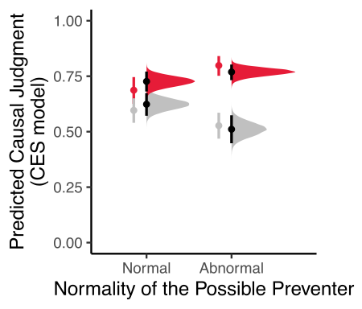{.absolute left="10%" width=600}


:::{.fragment .fade-out .ucl-white-bg .absolute .translateXY style="width: 600px; height: 100px; left: 450px; bottom: -42px;"}
:::


:::{}
::::{ .absolute .translateXY style="width: 50px; height: 50px; right: 300px; top: 300px; background-color: #C0C0C0;"}
::::

{.absolute .translateXY style="width: 100px; height: 100px; right: 125px; top: 300px;"}

::::{ .absolute .translateXY style="width: 50px; height: 50px; right: 300px; top: 450px; background-color: #E61C38;"}
::::

{.absolute .translateXY style="width: 100px; height: 100px; right: 125px; top: 450px;"}
:::

:::{.fragment .fade-out}
::::{.ucl-white-bg .absolute .translateXY style="width: 100px; height: 120px; left: 390px; top: 330px;"}
::::

::::{.ucl-white-bg .absolute .translateXY style="width: 100px; height: 40px; left: 350px; bottom: 48px;"}
::::
:::


:::{.fragment .fade-out .ucl-white-bg .absolute .translateXY style="width: 25px; height: 120px; left: 325px; top: 330px;"}
:::


## Temporal ordering<br>moderates judgments

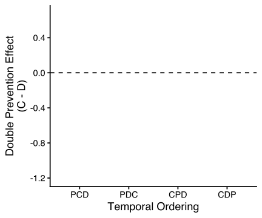{.absolute left="10%" width=600}

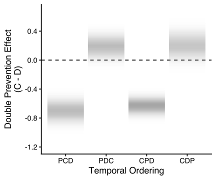{.fragment .absolute left="10%" width=600}

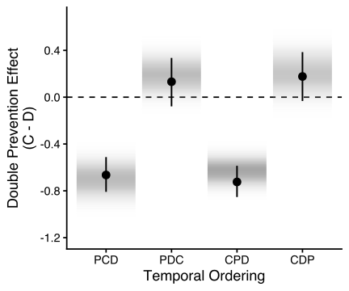{.fragment .absolute left="10%" width=600}


# Interim summary {.dark}

<br>

[**When people judge causal relationships, they imagine what could have happened**]{.ucl-light-purple}

<br>

[This explains:]{.fragment fragment-index=1}

:::{.much-smaller}
<ul>
    <li class="fragment" data-fragment-index=1>where their eyes fixate, even with no visual stimulus</li>
    <li class="fragment" data-fragment-index=2>their judgments of complex scenarios</li>
    <li class="fragment" data-fragment-index=3>how judgments are moderated by other factors</li>
</ul>
:::


