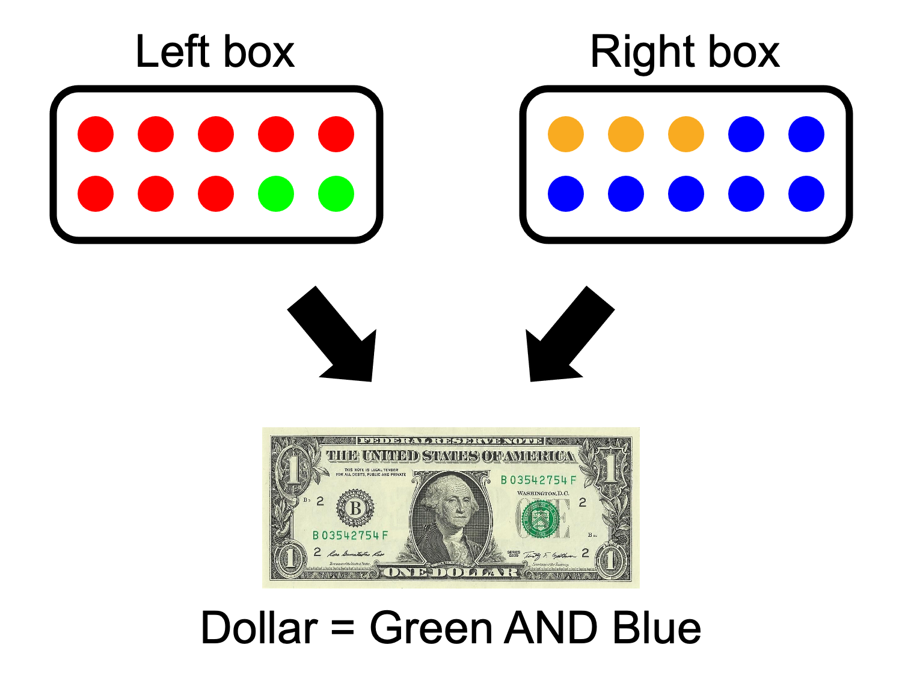
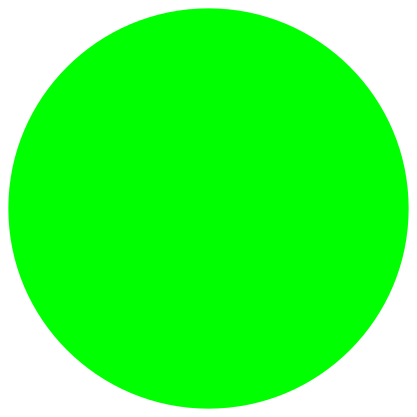
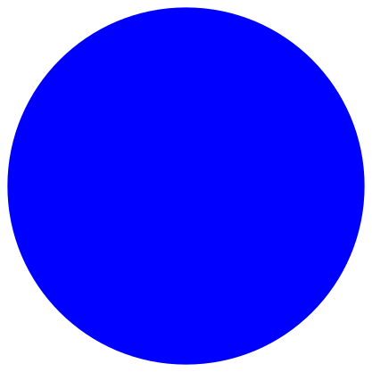
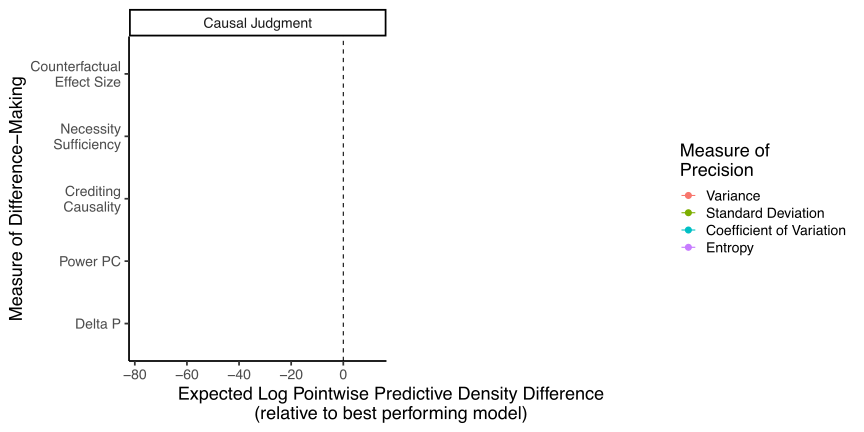
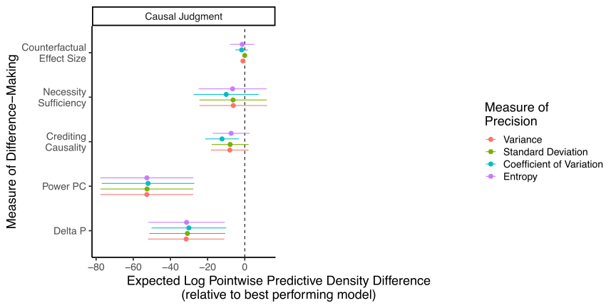
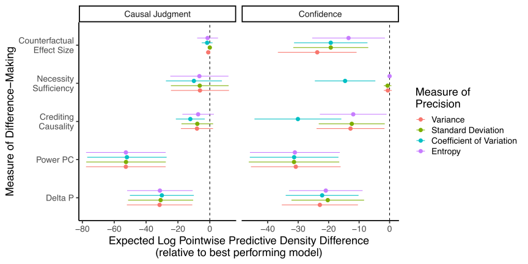

# {.dark}
:::{style="font-size: 3em; display: inline-block; width: 15%;"}
<h1 class="ucl-light-purple">2</h1>
:::
:::{style="display: inline-block; width: 80%;"}
<h2>Metacognition<br>about modal cognition</h2>
:::

:::{.ucl-pale-purple .much-smaller}
O'Neill, K., Henne, P., Bello, P., Pearson, J., & De Brigard, F. (2022).<br>&emsp;&emsp;Confidence and gradation in causal judgment. *Cognition.*

O'Neill, K., Henne, P., Pearson, J., & De Brigard, F. (2024).<br>&emsp;&emsp;Modeling confidence in causal judgments.<br>&emsp;&emsp;*Journal of experimental psychology: general.*
:::


## Confidence in causal judgments

:::{style="font-size: 3em"}
::::{.circle .ucl-light-purple-bg .absolute width=150 height=150 top=100 left=200}
<i class="fa-solid fa-plane"></i>
::::

::::{.circle .ucl-light-orange-bg .absolute width=150 height=150 bottom=100 left=200}
<i class="fa-solid fa-ban"></i>
::::

::::{.absolute .center-horizontally top=200 style="rotate: 20deg;"}
<i class="fa-solid fa-arrow-right-long"></i>
::::

::::{.absolute .center-horizontally bottom=200 style="rotate: -20deg;"}
<i class="fa-solid fa-arrow-right-long"></i>
::::

::::{.circle .ucl-light-purple-bg .absolute width=150 height=150 right=200 .center-vertically}
<i class="fa-solid fa-music"></i>
::::
:::


:::{.much-smaller .ucl-light-orange .center-text .absolute right=150 top=150 width=300}
*What caused you to miss the concert?*
:::


```{r}
#| label: functions_gradation
#| cache: false
#| include: false

## A custom ggplot theme
palette_GC <- wesanderson::wes_palette('Darjeeling1', n=3)

theme_GC <- function(..., palette=palette_GC) {
  list(
    scale_x_continuous(breaks=seq(0, 1, by=.25), labels=c('0', '.25', '.5', '.75', '1')),
    scale_y_continuous(breaks=seq(0, 1, by=.25), labels=c('0', '.25', '.5', '.75', '1')),
    scale_fill_manual(
      values=palette, name='Discrete\nCausal\nJudgment',
      breaks=c('totally caused', 'partially caused', 'did not cause'),
      drop=FALSE
    ),
    scale_color_manual(
      values=palette, name='Discrete\nCausal\nJudgment',
      breaks=c('totally caused', 'partially caused', 'did not cause'),
      drop=FALSE
    ),
    theme_classic(...),
    theme(
      axis.title.x=element_text(size=20, margin=margin(t=10)),
      axis.title.y=element_text(size=20, margin=margin(r=10)),
      axis.text.x=element_text(size=16, margin=margin(t=5)),
      axis.text.y=element_text(size=16, margin=margin(r=5)),
      legend.text=element_text(size=15),
      legend.title=element_text(size=20)
    )
  ) 
}


marginal_plot <- function(data, var, axis='x') {
  if (axis=='x') {
    data |>
      mutate(!!sym(var) := pmax(0.0, pmin(1.0, !!sym(var)))) |>
      ggplot(aes(x=!!sym(var))) +
      stat_slab(
        aes(fill=MC_resp), alpha=.33,
        density=density_bounded(bounds=c(0, 1), bandwidth=.01)
      ) +
      stat_slab(
        aes(color=MC_resp), fill=NA,
        density=density_bounded(bounds=c(0, 1), bandwidth=.01)
      ) +
      coord_cartesian(xlim=c(0, 1), ylim=c(0, 1), expand=FALSE) +
      scale_fill_manual(
        values=palette_GC, name='Discrete\nCausal\nJudgment', drop=FALSE,
        breaks=c('totally caused', 'partially caused', 'did not cause'),
      ) +
      scale_color_manual(
        values=palette_GC, name='Discrete\nCausal\nJudgment', drop=FALSE,
        breaks=c('totally caused', 'partially caused', 'did not cause')
      ) +
      theme_void(paper=ucl_white) +
      theme(
        axis.title.y=element_blank(),
        axis.text.y=element_blank(),
        axis.ticks.y=element_blank(),
        axis.line.y=element_blank(),
        axis.text.x=element_blank(),
        plot.title=element_text(hjust = 0.5),
        legend.position='none'
      )
  } else {
    data |>
      mutate(!!sym(var) := pmax(0.0, pmin(1.0, !!sym(var)))) |>
      ggplot(aes(y=!!sym(var))) +
      stat_slab(
        aes(fill=MC_resp), alpha=.33,
        density=density_bounded(bounds=c(0, 1), bandwidth=.01)
      ) +
      stat_slab(
        aes(color=MC_resp), fill=NA,
        density=density_bounded(bounds=c(0, 1), bandwidth=.01)
      ) +
      coord_cartesian(xlim=c(0, 1), ylim=c(0, 1), expand=FALSE) +
      scale_fill_manual(
        values=palette_GC, name='Discrete\nCausal\nJudgment', drop=FALSE,
        breaks=c('totally caused', 'partially caused', 'did not cause'),
      ) +
      scale_color_manual(
        values=palette_GC, name='Discrete\nCausal\nJudgment', drop=FALSE,
        breaks=c('totally caused', 'partially caused', 'did not cause')
      ) +
      theme_void(paper=ucl_white) +
      theme(
        axis.title.x=element_blank(),
        axis.text.x=element_blank(),
        axis.ticks.x=element_blank(),
        axis.line.x=element_blank(),
        axis.text.y=element_blank(),
        plot.title=element_text(hjust = 0.5),
        legend.position='none'
      )
  }
}

gradation_plot <- function(...,
  plot_levels=levels(data_gradation$MC_resp),
  marginal_levels=plot_levels
) {
  p_gradation_conf <- data_gradation |>
    filter(MC_resp %in% marginal_levels) |>
    marginal_plot('MC_conf')
  p_gradation_predictions <- predictions_gradation |>
    filter(MC_resp %in% marginal_levels) |>
    marginal_plot('.prediction', axis='y')
  p_gradation <- draws_gradation |>
    filter(MC_resp %in% plot_levels) |>
    ggplot(aes(x=MC_conf, y=.linpred)) +
    geom_ribbon(aes(fill=MC_resp, ymin=.linpred.lower, ymax=.linpred.upper),
      alpha=.33) +
    geom_line(aes(color=MC_resp), linewidth=2) +
    coord_fixed(xlim=c(0,1), ylim=c(0,1), expand=FALSE) +
    xlab('Confidence') + ylab('Continuous Causal Judgment') +
    theme_GC(...)
  (p_gradation_conf + plot_spacer() +
    p_gradation + p_gradation_predictions) +
    plot_layout(guides='collect', widths=c(-1, .33), heights=c(.33, -1))
}
```


```{r}
#| label: setup_gradation
#| include: false

data_gradation <- read_csv('https://github.com/kevingoneill/AreCausalJudgmentsGraded/raw/refs/heads/master/data/processed_data.csv') |>
  mutate(MC_conf=MC_conf/100,
    VAS_resp=VAS_resp/100,
    VAS_conf=VAS_conf/100,
    MC_resp=factor(MC_resp, levels=c(
      'partially caused',
      'did not cause',
      'totally caused'
    )),
    normality=factor(
      ifelse(condition %in% c('N', 'I'), 'normal', 'abnormal'),
      levels=c('normal', 'abnormal')
    ))

## Fit heteroscedastic Gaussian model
m_gradation <- brm(
  bf(
    VAS_resp ~ MC_resp * MC_conf + (1 |i| id) +
      (1 |v| vignette:structure:condition),
    sigma ~ MC_resp * MC_conf + (1 |i| id) +
      (1 |v| vignette:structure:condition)
  ), prior=c(
    set_prior('normal(0, 1.0)'),
    set_prior('normal(0, 5.0)', dpar='sigma')
  ), save_pars=save_pars(all=TRUE), data=data_gradation,
  file='_models/gradation', cores=4, iter=5000, inits="0"
) |>
  recover_types()
summary(m_gradation)


data_gradation <- data_gradation |>
  mutate(MC_resp=factor(MC_resp, levels=c(
    'did not cause', 'partially caused', 'totally caused'
  )))
draws_gradation <- data_gradation |>
  distinct(MC_resp) |>
  expand_grid(MC_conf=seq(0, 1, by=.01)) |>
  add_linpred_draws(m_gradation, transform=TRUE, dpar='sigma', re_formula=NA) |>
  median_qi()

predictions_gradation <- data_gradation |>
  add_predicted_draws(m_gradation, ndraws=50)
```

## How should we interpret causal judgments?

:::{.ucl-light-blue .fragment fragment-index=4 style="text-align: center;"}
*"I'm more confident that X was the cause"*
:::

:::{.r-stack}
::::{.fragment fragment-index=1}
```{.tikz width=700}
%%| filename: gradation_2
%%| additionalPackages: \usepackage{cmbright}
\include{tikz_header2.tex}
\begin{tikzpicture}
    \node[hidden] (concepts) [] {imagined\\possibilities};
    \node[] (judgments) [right=1cm of concepts] {causal\\judgment};
    \node[hidden] (confidence) [right=-.5cm of concepts, yshift=1.5cm] {confidence};
    
    \path[hidden, line width=1.5pt, color=UCL_light_orange] (concepts) edge (judgments);
    \path[hidden, line width=1.5pt, color=UCL_light_blue] (concepts) edge (confidence);
    \path[hidden, line width=1.5pt, color=UCL_light_blue] (confidence) edge (judgments);
\end{tikzpicture}
```
::::

::::{.fragment fragment-index=2}
```{.tikz width=700}
%%| filename: gradation_3
%%| additionalPackages: \usepackage{cmbright}
\include{tikz_header2.tex}
\begin{tikzpicture}
    \node[] (concepts) [] {imagined\\possibilities};
    \node[] (judgments) [right=1cm of concepts] {causal\\judgment};
    \node[hidden] (confidence) [right=-.5cm of concepts, yshift=1.5cm] {confidence};
    
    \path[line width=1.5pt, color=UCL_light_orange] (concepts) edge (judgments);
    \path[hidden, line width=1.5pt, color=UCL_light_blue] (concepts) edge (confidence);
    \path[hidden, line width=1.5pt, color=UCL_light_blue] (confidence) edge (judgments);
\end{tikzpicture}
```
::::

::::{.fragment fragment-index=3}
```{.tikz width=700}
%%| filename: gradation_4
%%| additionalPackages: \usepackage{cmbright}
\include{tikz_header2.tex}
\begin{tikzpicture}
    \node[] (concepts) [] {imagined\\possibilities};
    \node[] (judgments) [right=1cm of concepts] {causal\\judgment};
    \node[] (confidence) [right=-.5cm of concepts, yshift=1.5cm] {confidence};
    
    \path[line width=1.5pt, color=UCL_light_orange, draw] (concepts) edge (judgments);
    \path[line width=1.5pt, color=UCL_light_blue, draw] (concepts) edge (confidence);
    \path[line width=1.5pt, color=UCL_light_blue, draw] (confidence) edge (judgments);
\end{tikzpicture}
```
::::
:::

:::{.ucl-light-orange .fragment fragment-index=4 style="text-align: center;"}
*"X caused Y to a greater degree"*
:::

## Methods

:::{.columns}
::::{.column width="60%"}
:::::{.center-vertically}
{style="width: 60%" .fragment fragment-index=1}
:::::

:::::{.ucl-white-bg .absolute top=295 left=135 width=355 height=275 .fragment .fade-out fragment-index=2}
:::::

:::::{.ucl-light-blue-outline .absolute top=229 left=217 width=25 height=25 style="border-radius: 5px; padding: 4px;" .fragment fragment-index=3}
:::::
:::::{.ucl-light-blue-outline .absolute top=229 left=542 width=25 height=25 style="border-radius: 5px; padding: 4px;" .fragment fragment-index=3}
:::::
::::

::::{.column .much-smaller width="40%"}
:::::{.center-vertically}
[To what extent did Joe win the dollar because he drew [the green ball]{.ucl-light-green}?]{.fragment fragment-index=4}

[How confident are you in your response?]{.fragment fragment-index=5}
:::::
::::
:::

:::{.bottom-left .tiny}
@ONeill2022
:::


## Methods

:::{.r-stack}
::::{}
```{.tikz width=800}
%%| filename: gradation_design_1
%%| additionalPackages: \usepackage{soul, cmbright}
\include{tikz_header2.tex}
\begin{tikzpicture}[every node/.style={minimum size=4cm, text width=4cm, align=center, draw=black, fill=UCL_paper_white, text=black, line width=1pt}, scale=0.5, node distance=1.5cm and 1.5cm]
    \node[] (vignette) [] {Vignette};
    \node[hidden] (discrete) [right=of vignette, yshift=3cm] {X \underline{\hspace{1cm}} Y.\\\vspace{.66cm}did not cause\\partially caused\\totally caused};
    \node[hidden] (continuous) [right=of vignette, yshift=-3cm] {To what extent did\\X cause Y?\\\vspace{1cm}\st{$\quad\qquad\vert\quad\qquad$}};
    \node[hidden] (confidence) [right=of discrete, yshift=-3cm] {How confident are you?\\\vspace{1cm}\st{$\quad\qquad\vert\quad\qquad$}};
    
    \path[hidden, line width=2pt] (vignette) edge (discrete);
    \path[hidden, line width=2pt] (vignette) edge (continuous);
    \path[hidden, line width=2pt] (discrete) edge (confidence);
    \path[hidden, line width=2pt] (continuous) edge (confidence);
\end{tikzpicture}
```
::::

::::{.fragment}
```{.tikz width=800}
%%| filename: gradation_design_2
%%| additionalPackages: \usepackage{soul, cmbright}
\include{tikz_header2.tex}
\begin{tikzpicture}[every node/.style={minimum size=4cm, text width=4cm, align=center, draw=black, fill=UCL_paper_white, text=black, line width=1pt}, scale=0.5, node distance=1.5cm and 1.5cm]
    \node[] (vignette) [] {Vignette};
    \node[hidden] (discrete) [right=of vignette, yshift=3cm] {X \underline{\hspace{1cm}} Y.\\\vspace{.66cm}did not cause\\partially caused\\totally caused};
    \node[] (continuous) [right=of vignette, yshift=-3cm] {To what extent did\\X cause Y?\\\vspace{1cm}\st{$\quad\qquad\vert\quad\qquad$}};
    \node[hidden] (confidence) [right=of discrete, yshift=-3cm] {How confident are you?\\\vspace{1cm}\st{$\quad\qquad\vert\quad\qquad$}};
    
    \path[hidden, line width=2pt] (vignette) edge (discrete);
    \path[line width=2pt] (vignette) edge (continuous);
    \path[hidden, line width=2pt] (discrete) edge (confidence);
    \path[hidden, line width=2pt] (continuous) edge (confidence);
\end{tikzpicture}
```
::::

::::{.fragment}
```{.tikz width=800}
%%| filename: gradation_design_3
%%| additionalPackages: \usepackage{soul, cmbright}
\include{tikz_header2.tex}
\begin{tikzpicture}[every node/.style={minimum size=4cm, text width=4cm, align=center, draw=black, fill=UCL_paper_white, text=black, line width=1pt}, scale=0.5, node distance=1.5cm and 1.5cm]
    \node[] (vignette) [] {Vignette};
    \node[hidden] (discrete) [right=of vignette, yshift=3cm] {X \underline{\hspace{1cm}} Y.\\\vspace{.66cm}did not cause\\partially caused\\totally caused};
    \node[] (continuous) [right=of vignette, yshift=-3cm] {To what extent did\\X cause Y?\\\vspace{1cm}\st{$\quad\qquad\vert\quad\qquad$}};
    \node[] (confidence) [right=of discrete, yshift=-3cm] {How confident are you?\\\vspace{1cm}\st{$\quad\qquad\vert\quad\qquad$}};
    
    \path[hidden, line width=2pt] (vignette) edge (discrete);
    \path[line width=2pt] (vignette) edge (continuous);
    \path[hidden, line width=2pt] (discrete) edge (confidence);
    \path[line width=2pt] (continuous) edge (confidence);
\end{tikzpicture}
```
::::

::::{.fragment}
```{.tikz width=800}
%%| filename: gradation_design_4
%%| additionalPackages: \usepackage{soul, cmbright}
\include{tikz_header2.tex}
\begin{tikzpicture}[every node/.style={minimum size=4cm, text width=4cm, align=center, draw=black, fill=UCL_paper_white, text=black, line width=1pt}, scale=0.5, node distance=1.5cm and 1.5cm]
    \node[] (vignette) [] {Vignette};
    \node[] (discrete) [right=of vignette, yshift=3cm] {X \underline{\hspace{1cm}} Y.\\\vspace{.66cm}did not cause\\partially caused\\totally caused};
    \node[] (continuous) [right=of vignette, yshift=-3cm] {To what extent did\\X cause Y?\\\vspace{1cm}\st{$\quad\qquad\vert\quad\qquad$}};
    \node[] (confidence) [right=of discrete, yshift=-3cm] {How confident are you?\\\vspace{1cm}\st{$\quad\qquad\vert\quad\qquad$}};
    
    \path[line width=2pt] (vignette) edge (discrete);
    \path[line width=2pt] (vignette) edge (continuous);
    \path[line width=2pt] (discrete) edge (confidence);
    \path[line width=2pt] (continuous) edge (confidence);
\end{tikzpicture}
```
::::

::::{.fragment .ucl-white-bg}
```{.tikz width=800}
%%| filename: gradation_design_5
%%| additionalPackages: \usepackage{soul, cmbright}
\include{tikz_header2.tex}
\begin{tikzpicture}[every node/.style={minimum size=4cm, text width=4cm, align=center, draw=black, fill=UCL_paper_white, text=black, line width=1pt}, scale=0.5, node distance=1.5cm and 1.5cm]
    \node[] (vignette) [] {Vignette};
    \node[line width=2pt, draw=UCL_light_blue] (discrete) [right=of vignette, yshift=3cm] {X \underline{\hspace{1cm}} Y.\\\vspace{.66cm}did not cause\\partially caused\\totally caused};
    \node[line width=2pt, draw=UCL_light_orange] (continuous) [right=of vignette, yshift=-3cm] {To what extent did\\X cause Y?\\\vspace{1cm}\st{$\quad\qquad\vert\quad\qquad$}};
    \node[line width=2pt, draw=UCL_light_blue] (confidence) [right=of discrete, yshift=-3cm] {How confident are you?\\\vspace{1cm}\st{$\quad\qquad\vert\quad\qquad$}};
    
    \path[line width=2pt] (vignette) edge (discrete);
    \path[line width=2pt] (vignette) edge (continuous);
    \path[line width=2pt] (discrete) edge (confidence);
    \path[line width=2pt] (continuous) edge (confidence);
\end{tikzpicture}
```
::::
:::

:::{.bottom-left .tiny}
@ONeill2022
:::


## [Confidence predicts causal judgments]{style="position: relative; z-index: 999;"}

:::{.absolute top=100 left=200}
:::{.r-stack}
::::{.fragment fragment-index=1}
```{r}
#| label: gradation_2
#| fig-width: 8
#| fig-height: 6
gradation_plot(plot_levels=c('totally caused'))
```
::::

::::{.fragment fragment-index=3}
```{r}
#| label: gradation_3
#| fig-width: 8
#| fig-height: 6
gradation_plot(plot_levels=c('totally caused', 'did not cause'))
```
::::

::::{.fragment fragment-index=4}
```{r}
#| label: gradation_4
#| fig-width: 8
#| fig-height: 6
gradation_plot()
```
::::
:::
:::

:::{.ucl-white-bg .absolute width=325 height=325 top=255 left=289 .fragment .fade-out fragment-index=2}
:::

:::{.bottom-left .tiny}
@ONeill2022
:::


## [Confidence predicts variability in causal judgments]{style="position: relative; z-index: 999;"}

:::{.absolute left=200}
```{r}
#| label: gradation_sd_1
#| fig-width: 8
#| fig-height: 6
p.sd <- ggplot(
  draws_gradation,
  aes(x=MC_conf, y=sigma, ymin=sigma.lower, ymax=sigma.upper)
) +
  geom_line(aes(color=MC_resp), alpha=0) +
  coord_fixed(xlim=c(0,1), ylim=c(0,1), expand=FALSE) +
  xlab('Confidence') + ylab('Standard Deviation of\nContinuous Causal Judgments') +
  theme_GC(base_size=24)

p.sd
```
:::


:::{.absolute left=200 .fragment}
```{r}
#| label: gradation_sd_2
#| fig-width: 8
#| fig-height: 6
p.sd + geom_line(aes(color=MC_resp), linewidth=2) +
  geom_ribbon(aes(fill=MC_resp), alpha=0.3)
```
:::

:::{.bottom-left .tiny}
@ONeill2022
:::


```{r}
#| label: libraries_cft_confidence
library(viridis)
library(ggtext)
```

```{r}
#| label: setup_cft_confidence
#| include: false
#| cache: false
d_conf <- read_csv('https://github.com/kevingoneill/modeling-confidence-causal-judgments/raw/refs/heads/main/analyses/data/data-processed.csv')

d_gp <- read_csv('_data/epred_gp.csv') |>
  mutate(
    structure=recode_values(structure,
      'Conjunctive' ~ 'AND', 'Disjunctive' ~ 'OR'
    )
  )
d_ns <- read_csv('_data/epred_ns.csv') |>
  pivot_longer(
    starts_with('epred'), names_pattern='epred_(cause|confidence)(.*)',
    names_to=c('resp', 'est')
  ) |>
  mutate(
    est=ifelse(est=='', 'e_pred', est),
    resp=recode_values(resp,
      'cause' ~ 'Causal Judgment', 'confidence' ~ 'Confidence'
    ),
    structure=recode_values(structure,
      'Conjunctive' ~ 'AND', 'Disjunctive' ~ 'OR'
    )
  ) |>
  pivot_wider(names_from=est)

prob_img <- function(var='c', prob=50, width=50, format='png') {
  paste0(
    "</img>"
  )
}

theme_cft <- function(var='Causal Judgment', base_size=18, ...) {
  fill_range <- range(c(
    d_gp |> filter(resp==var) |> pull(e_pred),
    d_ns |> filter(resp==var) |> pull(e_pred)
  ))
  list(
    scale_x_continuous(breaks=c(.1, .5, 1),
      labels=prob_img(prob=c(10, 50, 100))
    ),
    scale_y_continuous(breaks=c(.1, .5, 1),
      labels=prob_img('a', prob=c(10, 50, 100))
    ),
    scale_fill_viridis(
      name=paste0('Mean\n', str_replace(var, ' ', '\n')),
      option='magma', limits=fill_range
    ),
    coord_fixed(xlim=c(0.05, 1.05), ylim=c(0.05, 1.05),
      expand=FALSE),
    xlab("Probability of </img>"),
    ylab("Probability of </img>"),
    facet_grid(structure ~ .),
    theme_classic(base_size=base_size, ...) +
      theme(
        axis.title.x=element_markdown(),
        axis.title.y=element_markdown(),
        axis.text.x=element_markdown(),
        axis.text.y=element_markdown()
      )
  )
}
```

## Confidence in causal judgments

:::{.columns .fragment fragment-index=1}
::::{.column width="20%"}
::::{.center-vertically .center-text}
:::{.box .ucl-dark-purple-outline .ucl-dark-purple .ucl-white-bg style="width: 175px; margin: 10px; padding: 5px; padding-top: 1px; padding-bottom: 1px; outline: dashed !important;"}
[<i class="fa-solid fa-ban"></i>]{}
<i class="fa-solid fa-arrow-right-long"></i>
[<i class="fa-solid fa-music"></i>]{style="opacity: 40%;"}
:::

:::{.box .ucl-dark-purple-outline .ucl-dark-purple .ucl-white-bg style="width: 175px; margin: 10px; padding: 5px; padding-top: 1px; padding-bottom: 1px; outline: dashed !important;"}
[<i class="fa-solid fa-ban"></i>]{}
<i class="fa-solid fa-arrow-right-long"></i>
[<i class="fa-solid fa-music"></i>]{}
:::

:::{.box .ucl-dark-purple-outline .ucl-dark-purple .ucl-white-bg style="width: 175px; margin: 10px; padding: 5px; padding-top: 1px; padding-bottom: 1px; outline: dashed !important;"}
[<i class="fa-solid fa-ban"></i>]{}
<i class="fa-solid fa-arrow-right-long"></i>
[<i class="fa-solid fa-music"></i>]{style="opacity: 40%;"}
:::

:::{.box .ucl-dark-purple-outline .ucl-dark-purple .ucl-white-bg style="width: 175px; margin: 10px; padding: 5px; padding-top: 1px; padding-bottom: 1px; outline: dashed !important;"}
[<i class="fa-solid fa-ban"></i>]{}
<i class="fa-solid fa-arrow-right-long"></i>
[<i class="fa-solid fa-music"></i>]{}
:::

:::{.box .ucl-dark-purple-outline .ucl-dark-purple .ucl-white-bg style="width: 175px; margin: 10px; padding: 5px; padding-top: 1px; padding-bottom: 1px; outline: dashed !important;"}
[<i class="fa-solid fa-ban"></i>]{}
<i class="fa-solid fa-arrow-right-long"></i>
[<i class="fa-solid fa-music"></i>]{style="opacity: 40%;"}
:::

:::{.box .ucl-dark-purple-outline .ucl-dark-purple .ucl-white-bg style="width: 175px; margin: 10px; padding: 5px; padding-top: 1px; padding-bottom: 1px; outline: dashed !important;"}
[<i class="fa-solid fa-ban"></i>]{}
<i class="fa-solid fa-arrow-right-long"></i>
[<i class="fa-solid fa-music"></i>]{style="opacity: 40%;"}
:::
::::
::::

::::{.column width="15%"}
::::{.center-vertically .center-text style="font-size: 6em;" .fragment .fade-out fragment-index=2}
```{=html}
-
```
::::

::::{.center-vertically .center-text style="font-size: 1.33em;" .fragment fragment-index=2}
:::{.box .ucl-white-bg style="width: 125px; margin: 10px; padding: 5px;"}
```{=html}
-
```
:::

:::{.box .ucl-white-bg style="width: 125px; margin: 10px; padding: 5px;"}
```{=html}
-
```
:::

:::{.box .ucl-white-bg style="width: 125px; margin: 10px; padding: 5px;"}
```{=html}
-
```
:::

:::{.box .ucl-white-bg style="width: 125px; margin: 10px; padding: 5px;"}
```{=html}
-
```
:::

:::{.box .ucl-white-bg style="width: 125px; margin: 10px; padding: 5px;"}
```{=html}
-
```
:::

:::{.box .ucl-white-bg style="width: 125px; margin: 10px; padding: 5px;"}
```{=html}
-
```
:::
::::
::::

::::{.column width="20%"}
::::{.center-vertically .center-text}
:::{.box .ucl-dark-purple-outline .ucl-dark-purple .ucl-white-bg style="width: 175px; margin: 10px; padding: 5px; padding-top: 1px; padding-bottom: 1px; outline: dashed !important;"}
[<i class="fa-solid fa-ban"></i>]{style="opacity: 40%;"}
<i class="fa-solid fa-arrow-right-long"></i>
[<i class="fa-solid fa-music"></i>]{}
:::

:::{.box .ucl-dark-purple-outline .ucl-dark-purple .ucl-white-bg style="width: 175px; margin: 10px; padding: 5px; padding-top: 1px; padding-bottom: 1px; outline: dashed !important;"}
[<i class="fa-solid fa-ban"></i>]{style="opacity: 40%;"}
<i class="fa-solid fa-arrow-right-long"></i>
[<i class="fa-solid fa-music"></i>]{style="opacity: 40%;"}
:::

:::{.box .ucl-dark-purple-outline .ucl-dark-purple .ucl-white-bg style="width: 175px; margin: 10px; padding: 5px; padding-top: 1px; padding-bottom: 1px; outline: dashed !important;"}
[<i class="fa-solid fa-ban"></i>]{style="opacity: 40%;"}
<i class="fa-solid fa-arrow-right-long"></i>
[<i class="fa-solid fa-music"></i>]{}
:::

:::{.box .ucl-dark-purple-outline .ucl-dark-purple .ucl-white-bg style="width: 175px; margin: 10px; padding: 5px; padding-top: 1px; padding-bottom: 1px; outline: dashed !important;"}
[<i class="fa-solid fa-ban"></i>]{style="opacity: 40%;"}
<i class="fa-solid fa-arrow-right-long"></i>
[<i class="fa-solid fa-music"></i>]{}
:::

:::{.box .ucl-dark-purple-outline .ucl-dark-purple .ucl-white-bg style="width: 175px; margin: 10px; padding: 5px; padding-top: 1px; padding-bottom: 1px; outline: dashed !important;"}
[<i class="fa-solid fa-ban"></i>]{style="opacity: 40%;"}
<i class="fa-solid fa-arrow-right-long"></i>
[<i class="fa-solid fa-music"></i>]{}
:::

:::{.box .ucl-dark-purple-outline .ucl-dark-purple .ucl-white-bg style="width: 175px; margin: 10px; padding: 5px; padding-top: 1px; padding-bottom: 1px; outline: dashed !important;"}
[<i class="fa-solid fa-ban"></i>]{style="opacity: 40%;"}
<i class="fa-solid fa-arrow-right-long"></i>
[<i class="fa-solid fa-music"></i>]{}
:::
::::
::::

::::{.column width="15%"}
::::{.center-vertically .center-text style="font-size: 6em;"}
=
::::
::::

::::{.column width="20%"}
:::::{.center-vertically .center-text .fragment .fade-out fragment-index=3}
*"The flight cancellations caused me to miss the concert"*
:::::

:::::{.center-vertically .center-text .fragment fragment-index=3}
*"I'm confident that the flight cancellations caused me to miss the concert"*
:::::
::::
:::


## Confidence in causal judgments

:::{.columns}
::::{.column width="20%"}
::::{.center-vertically .center-text}
:::{.box .ucl-dark-purple-outline .ucl-dark-purple .ucl-white-bg style="width: 175px; margin: 10px; padding: 5px; padding-top: 1px; padding-bottom: 1px; outline: dashed !important;"}
[<i class="fa-solid fa-plane"></i>]{}
<i class="fa-solid fa-arrow-right-long"></i>
[<i class="fa-solid fa-music"></i>]{}
:::

:::{.box .ucl-dark-purple-outline .ucl-dark-purple .ucl-white-bg style="width: 175px; margin: 10px; padding: 5px; padding-top: 1px; padding-bottom: 1px; outline: dashed !important;"}
[<i class="fa-solid fa-plane"></i>]{}
<i class="fa-solid fa-arrow-right-long"></i>
[<i class="fa-solid fa-music"></i>]{}
:::

:::{.box .ucl-dark-purple-outline .ucl-dark-purple .ucl-white-bg style="width: 175px; margin: 10px; padding: 5px; padding-top: 1px; padding-bottom: 1px; outline: dashed !important;"}
[<i class="fa-solid fa-plane"></i>]{}
<i class="fa-solid fa-arrow-right-long"></i>
[<i class="fa-solid fa-music"></i>]{style="opacity: 40%;"}
:::

:::{.box .ucl-dark-purple-outline .ucl-dark-purple .ucl-white-bg style="width: 175px; margin: 10px; padding: 5px; padding-top: 1px; padding-bottom: 1px; outline: dashed !important;"}
[<i class="fa-solid fa-plane"></i>]{}
<i class="fa-solid fa-arrow-right-long"></i>
[<i class="fa-solid fa-music"></i>]{}
:::

:::{.box .ucl-dark-purple-outline .ucl-dark-purple .ucl-white-bg style="width: 175px; margin: 10px; padding: 5px; padding-top: 1px; padding-bottom: 1px; outline: dashed !important;"}
[<i class="fa-solid fa-plane"></i>]{}
<i class="fa-solid fa-arrow-right-long"></i>
[<i class="fa-solid fa-music"></i>]{}
:::

:::{.box .ucl-dark-purple-outline .ucl-dark-purple .ucl-white-bg style="width: 175px; margin: 10px; padding: 5px; padding-top: 1px; padding-bottom: 1px; outline: dashed !important;"}
[<i class="fa-solid fa-plane"></i>]{}
<i class="fa-solid fa-arrow-right-long"></i>
[<i class="fa-solid fa-music"></i>]{}
:::
::::
::::

::::{.column width="15%"}
::::{.center-vertically .center-text style="font-size: 6em;" .fragment .fade-out fragment-index=1}
```{=html}
-
```
::::

::::{.center-vertically .center-text style="font-size: 1.33em;" .fragment fragment-index=1}
:::{.box .ucl-white-bg style="width: 125px; margin: 10px; padding: 5px;"}
```{=html}
-
```
:::

:::{.box .ucl-white-bg style="width: 125px; margin: 10px; padding: 5px;"}
```{=html}
-
```
:::

:::{.box .ucl-white-bg style="width: 125px; margin: 10px; padding: 5px;"}
```{=html}
-
```
:::

:::{.box .ucl-white-bg style="width: 125px; margin: 10px; padding: 5px;"}
```{=html}
-
```
:::

:::{.box .ucl-white-bg style="width: 125px; margin: 10px; padding: 5px;"}
```{=html}
-
```
:::

:::{.box .ucl-white-bg style="width: 125px; margin: 10px; padding: 5px;"}
```{=html}
-
```
:::
::::
::::

::::{.column width="20%"}
::::{.center-vertically .center-text}
:::{.box .ucl-dark-purple-outline .ucl-dark-purple .ucl-white-bg style="width: 175px; margin: 10px; padding: 5px; padding-top: 1px; padding-bottom: 1px; outline: dashed !important;"}
[<i class="fa-solid fa-plane"></i>]{style="opacity: 40%;"}
<i class="fa-solid fa-arrow-right-long"></i>
[<i class="fa-solid fa-music"></i>]{}
:::

:::{.box .ucl-dark-purple-outline .ucl-dark-purple .ucl-white-bg style="width: 175px; margin: 10px; padding: 5px; padding-top: 1px; padding-bottom: 1px; outline: dashed !important;"}
[<i class="fa-solid fa-plane"></i>]{style="opacity: 40%;"}
<i class="fa-solid fa-arrow-right-long"></i>
[<i class="fa-solid fa-music"></i>]{}
:::

:::{.box .ucl-dark-purple-outline .ucl-dark-purple .ucl-white-bg style="width: 175px; margin: 10px; padding: 5px; padding-top: 1px; padding-bottom: 1px; outline: dashed !important;"}
[<i class="fa-solid fa-plane"></i>]{style="opacity: 40%;"}
<i class="fa-solid fa-arrow-right-long"></i>
[<i class="fa-solid fa-music"></i>]{}
:::

:::{.box .ucl-dark-purple-outline .ucl-dark-purple .ucl-white-bg style="width: 175px; margin: 10px; padding: 5px; padding-top: 1px; padding-bottom: 1px; outline: dashed !important;"}
[<i class="fa-solid fa-plane"></i>]{style="opacity: 40%;"}
<i class="fa-solid fa-arrow-right-long"></i>
[<i class="fa-solid fa-music"></i>]{}
:::

:::{.box .ucl-dark-purple-outline .ucl-dark-purple .ucl-white-bg style="width: 175px; margin: 10px; padding: 5px; padding-top: 1px; padding-bottom: 1px; outline: dashed !important;"}
[<i class="fa-solid fa-plane"></i>]{style="opacity: 40%;"}
<i class="fa-solid fa-arrow-right-long"></i>
[<i class="fa-solid fa-music"></i>]{style="opacity: 40%;"}
:::

:::{.box .ucl-dark-purple-outline .ucl-dark-purple .ucl-white-bg style="width: 175px; margin: 10px; padding: 5px; padding-top: 1px; padding-bottom: 1px; outline: dashed !important;"}
[<i class="fa-solid fa-plane"></i>]{style="opacity: 40%;"}
<i class="fa-solid fa-arrow-right-long"></i>
[<i class="fa-solid fa-music"></i>]{}
:::
::::
::::

::::{.column width="15%"}
::::{.center-vertically .center-text style="font-size: 6em;"}
=
::::
::::

::::{.column width="20%"}
:::::{.center-vertically .center-text .fragment .fade-out fragment-index=1}
*"Traveling by plane didn't cause me to miss the concert"*
:::::

:::::{.center-vertically .center-text .fragment fragment-index=1}
*"I'm unsure whether traveling by plane caused me to miss the concert"*
:::::
::::
:::


## Confidence in causal judgments

:::{.larger .r-stack}
[$$E_{C=1} - E_{C=0}$$]{.absolute top=85 left=389 .fragment}

:::{.fragment .ucl-white-bg}
$$\textrm{Var}\left[E_{C=1} - E_{C=0}\right]$$
:::
:::

:::{.center-horizontally .fragment}
```{r}
#| label: conf_cause_1
#| fig-width: 5
#| fig-height: 4
p_conf_cause <- tibble(cause=seq(0, 1, by=.001)) |>
  mutate(conf = 1 - sqrt(cause*(1-cause))) |>
  ggplot(aes(x=cause, y=conf)) +
  xlab('Predicted mean\ncausal judgment') +
  ylab('Predicted mean\nconfidence') +
  coord_fixed(ratio=2) +
  theme_classic(18) +
  theme(
    axis.text=element_blank(),
    axis.ticks=element_blank()
  )

p_conf_cause
```
:::

:::{.center-horizontally .fragment}
```{r}
#| label: conf_cause_2
#| fig-width: 5
#| fig-height: 4
p_conf_cause +
  geom_line(color=ucl_mid_purple)
```
:::

## Methods

:::{.columns}
::::{.column width="60%"}
:::::{.center-vertically}
{style="width: 60%"}
:::::

:::::{.ucl-light-blue-outline .absolute top=229 left=217 width=25 height=25 style="border-radius: 5px; padding: 4px;"}
:::::
:::::{.ucl-light-blue-outline .absolute top=229 left=542 width=25 height=25 style="border-radius: 5px; padding: 4px;"}
:::::
::::

::::{.column .much-smaller width="40%"}
:::::{.center-vertically}
To what extent did Joe win the dollar because he drew [the green ball]{.ucl-light-green}?

How confident are you in your response?
:::::
::::
:::

:::{.bottom-left .tiny}
@ONeill2024
:::


## Normality affects<br>causal judgments

:::{.absolute left=100 top=150}
```{r}
#| label: gp_cause_1
#| fig-width: 10
#| fig-height: 6
p_gp_cause <- d_gp |>
  filter(resp=='Causal Judgment') |>
  ggplot(aes(x=p_C, y=p_A, fill=e_pred)) +
  theme_cft()

p_ns_cause <- d_ns |>
  filter(resp=='Causal Judgment') |>
  ggplot(aes(x=p_C, y=p_A, fill=e_pred)) +
  geom_tile(width=.101, height=.101) +
  theme_cft()

(p_gp_cause +
  guide_area() +
  hide_plot(p_ns_cause)) +
  plot_layout(guides='collect')
```
:::

:::{.absolute left=100 top=150 .fragment}
```{r}
#| label: gp_cause_2
#| fig-width: 10
#| fig-height: 6
((p_gp_cause +
  geom_tile(data=~ filter(., structure=='AND', p_A==.5), width=.101, height=.101)) +
  guide_area() +
  hide_plot(p_ns_cause)) +
  plot_layout(guides='collect')
```
:::

:::{.absolute left=100 top=150 .fragment}
```{r}
#| label: gp_cause_3
#| fig-width: 10
#| fig-height: 6
((p_gp_cause +
  geom_tile(data=~ filter(., structure=='AND', p_C==.5), width=.101, height=.101)) +
  guide_area() +
  hide_plot(p_ns_cause)) +
  plot_layout(guides='collect')
```
:::

:::{.absolute left=100 top=150 .fragment}
```{r}
#| label: gp_cause_4
#| fig-width: 10
#| fig-height: 6
((p_gp_cause +
  geom_tile(data=~ filter(., structure=='AND'), width=.101, height=.101)) +
  guide_area() +
  hide_plot(p_ns_cause)) +
  plot_layout(guides='collect')
```
:::

:::{.absolute left=100 top=150 .fragment}
```{r}
#| label: gp_cause_5
#| fig-width: 10
#| fig-height: 6
((p_gp_cause +
  geom_tile(data=~ filter(., structure=='AND' | p_A==.5), width=.101, height=.101)) +
  guide_area() +
  hide_plot(p_ns_cause)) +
  plot_layout(guides='collect')
```
:::

:::{.absolute left=100 top=150 .fragment}
```{r}
#| label: gp_cause_6
#| fig-width: 10
#| fig-height: 6
((p_gp_cause +
  geom_tile(data=~ filter(., structure=='AND' | p_C==.5), width=.101, height=.101)) +
  guide_area() +
  hide_plot(p_ns_cause)) +
  plot_layout(guides='collect')
```
:::

:::{.absolute left=100 top=150 .fragment}
```{r}
#| label: gp_cause_7
#| fig-width: 10
#| fig-height: 6
((p_gp_cause + geom_tile(width=.101, height=.101)) +
  guide_area() +
  hide_plot(p_ns_cause)) +
  plot_layout(guides='collect')
```
:::

:::{.absolute left=100 top=150 .fragment}
```{r}
#| label: gp_cause_8
#| fig-width: 10
#| fig-height: 6
((p_gp_cause + geom_tile(width=.101, height=.101)) +
  p_ns_cause +
  guide_area()) +
  plot_layout(guides='collect')
```
:::

:::{.bottom-left .tiny}
@ONeill2024
:::


## Normality affects confidence

:::{.absolute left=100 top=150}
```{r}
#| label: gp_conf_1
#| fig-width: 10
#| fig-height: 6
p_gp_conf <- d_gp |>
  filter(resp=='Confidence') |>
  ggplot(aes(x=p_C, y=p_A, fill=e_pred)) +
  theme_cft('Confidence')

p_ns_conf <- d_ns |>
  filter(resp=='Confidence') |>
  ggplot(aes(x=p_C, y=p_A, fill=e_pred)) +
  geom_tile(width=.101, height=.101) +
  theme_cft('Confidence')

(p_gp_conf +
  guide_area() +
  hide_plot(p_ns_conf)) +
  plot_layout(guides='collect')
```
:::

:::{.absolute left=100 top=150 .fragment}
```{r}
#| label: gp_conf_2
#| fig-width: 10
#| fig-height: 6
((p_gp_conf +
  geom_tile(data=~ filter(., structure=='AND', p_A==.5), width=.101, height=.101)) +
  guide_area() +
  hide_plot(p_ns_conf)) +
  plot_layout(guides='collect')
```
:::

:::{.absolute left=100 top=150 .fragment}
```{r}
#| label: gp_conf_3
#| fig-width: 10
#| fig-height: 6
((p_gp_conf +
  geom_tile(data=~ filter(., structure=='AND', p_C==.5), width=.101, height=.101)) +
  guide_area() +
  hide_plot(p_ns_conf)) +
  plot_layout(guides='collect')
```
:::

:::{.absolute left=100 top=150 .fragment}
```{r}
#| label: gp_conf_4
#| fig-width: 10
#| fig-height: 6
((p_gp_conf +
  geom_tile(data=~ filter(., structure=='AND'), width=.101, height=.101)) +
  guide_area() +
  hide_plot(p_ns_conf)) +
  plot_layout(guides='collect')
```
:::

:::{.absolute left=100 top=150 .fragment}
```{r}
#| label: gp_conf_5
#| fig-width: 10
#| fig-height: 6
((p_gp_conf +
  geom_tile(data=~ filter(., structure=='AND' | p_A==.5), width=.101, height=.101)) +
  guide_area() +
  hide_plot(p_ns_conf)) +
  plot_layout(guides='collect')
```
:::

:::{.absolute left=100 top=150 .fragment}
```{r}
#| label: gp_conf_6
#| fig-width: 10
#| fig-height: 6
((p_gp_conf +
  geom_tile(data=~ filter(., structure=='AND' | p_C==.5), width=.101, height=.101)) +
  guide_area() +
  hide_plot(p_ns_conf)) +
  plot_layout(guides='collect')
```
:::

:::{.absolute left=100 top=150 .fragment}
```{r}
#| label: gp_conf_7
#| fig-width: 10
#| fig-height: 6
((p_gp_conf + geom_tile(width=.101, height=.101)) +
  guide_area() +
  hide_plot(p_ns_conf)) +
  plot_layout(guides='collect')
```
:::

:::{.absolute left=100 top=150 .fragment}
```{r}
#| label: gp_conf_8
#| fig-width: 10
#| fig-height: 6
((p_gp_conf + geom_tile(width=.101, height=.101)) +
  p_ns_conf +
  guide_area()) +
  plot_layout(guides='collect')
```
:::

:::{.bottom-left .tiny}
@ONeill2024
:::


## Confidence discriminates between models


:::{.r-stack}
{.fragment width="100%"}

{.fragment width="100%"}

{.fragment width="100%"}
:::

:::{.bottom-left .tiny}
@ONeill2024
:::


# Interim summary {.dark}

<br>

[**When people evalute their causal judgments, they compute the robustness of a causal relationship**]{.ucl-light-purple}

<br>

[This explains:]{.fragment fragment-index=1}

:::{.much-smaller}
<ul>
    <li class="fragment" data-fragment-index=1>how to interpret graded causal judgments</li>
    <li class="fragment" data-fragment-index=2>how confidence is affected by normality</li>
    <li class="fragment" data-fragment-index=3>how confidence relates to causal judgments</li>
</ul>
:::

