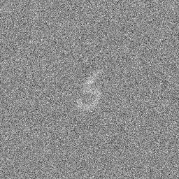
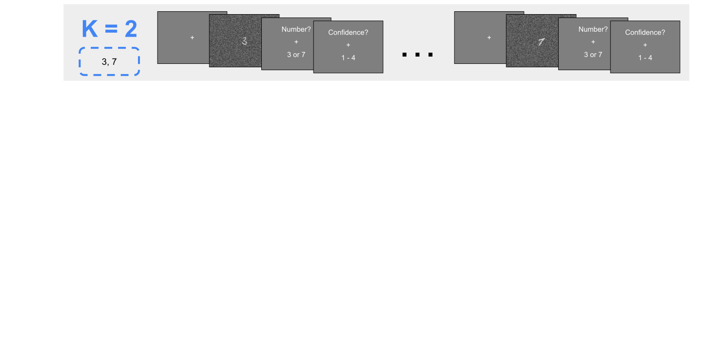
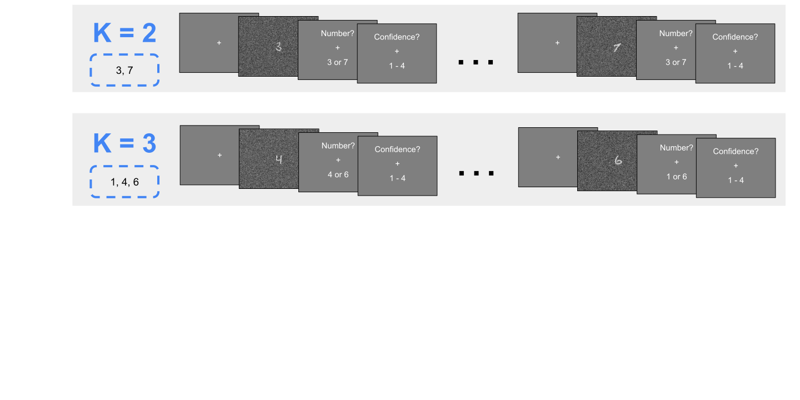
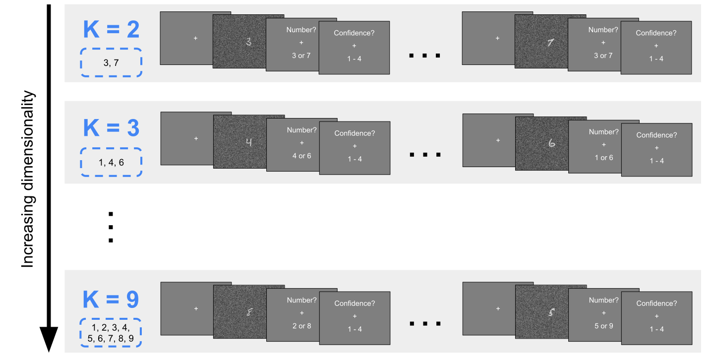
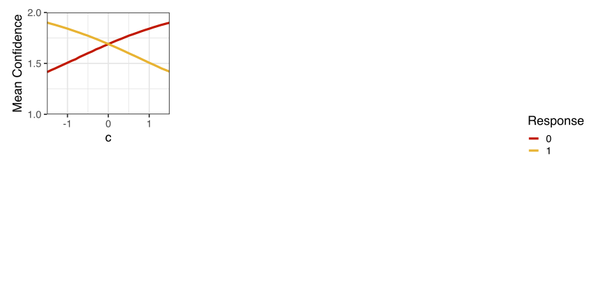
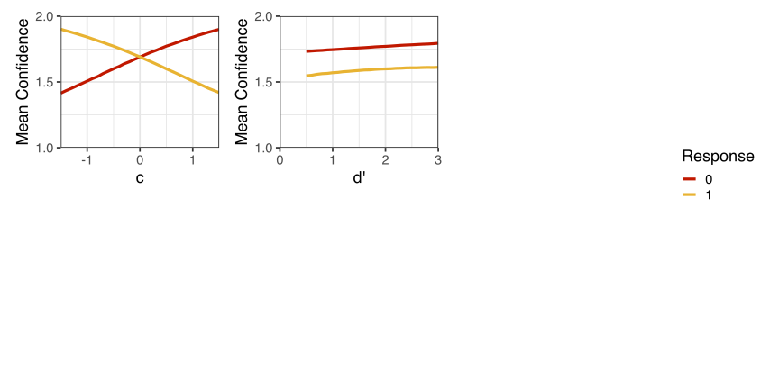
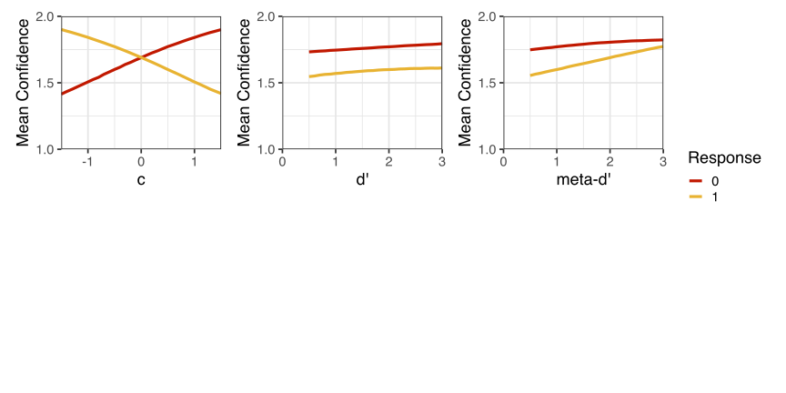
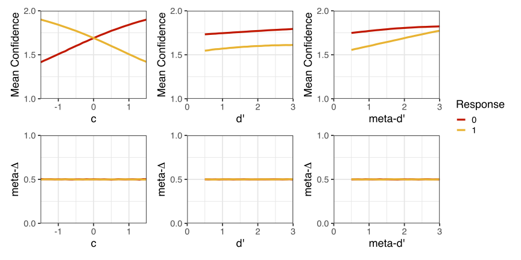
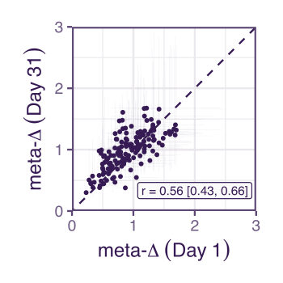

# {.dark}
:::{style="font-size: 3em; display: inline-block; width: 15%;"}
<h1 class="ucl-light-purple">3</h1>
:::
:::{style="display: inline-block; width: 80%;"}
<h2>Modal contributions to metacognition</h2>
:::


:::{.ucl-pale-purple .much-smaller style="width: 95%; line-height: 2;"}
Kozyra, W., O’Neill, K., & Fleming, S. M. (2026).<br>&emsp;&emsp;Confidence is detection-like in high-dimensional spaces. *Open Mind.*

O'Neill, K., & Fleming, S. M. (2026).<br>&emsp;&emsp;Quantifying metacognition with the hmetad package in R. *PsyArXiv.*

O'Neill, K., Zhan, T., & Fleming, S. (2026).<br>&emsp;&emsp;A measure of metacognitive bias you can be confident in.<br>&emsp;&emsp;In *Proceedings of the Annual Meeting of the Cognitive Science Society.*
:::

```{r}
#| label: metacog_libraries
#| include: false
#| cache: false
library(tidyverse)     # for data wrangling
library(ggdist)        # for distribution plots
library(LaplacesDemon) # for multivariate normal distributions
library(matrixStats)   # for efficient logSumExp() function
library(viridis)       # for color scales
library(patchwork)     # for multi-panel plots
library(emmeans)       # for linear regressions
```

```{r}
#| label: metacog_setup
#| include: false
#' softmax(x):
#'   calculate the softmax x
#' Arguments:
#'   x: a vector or matrix of values
#' Value:
#'   S: if x is a vector, the softmax of x.
#'      if x is a matrix, calculate the softmax for each row.
softmax <- function(x, beta=1) {
  if (is.vector(x)) {
    exp(beta*x - logSumExp(beta*x))        
  } else {
    exp(beta*x - rowLogSumExps(beta*x))
  }
}

#' Jsoftmax(x):
#'   calculate the Jacobian matrix of the softmax of x
#' Arguments:
#'   x: a vector of N values
#' Value:
#'   J: an NxN matrix where each entry J[i,j] represents
#'      the partial derivative of softmax(x)[i] with respect to x[j]
Jsoftmax <- function(x, beta=1) {
  s <- softmax(x, beta=beta)
  if (is.vector(x)) {
    beta * (diag(s) - outer(s, s))
  } else {
    apply(s, 1, function(x) beta * (diag(x) - outer(x, x)), simplify=FALSE)
  }
}

#' compute P(present | X)
detection_posterior <- function(x, mu_target=1) {
  k <- length(x)
  ll <- c(log(k) + .5 * mu_target^2,
          logSumExp(x*mu_target))
  return(exp(ll - logSumExp(ll)))
}


## plotting function for drawing a circle
geom_circle <- function(center=c(0, 0), radius=1, n=101, ...) {
  d <- tibble(theta=seq(0, 2*pi, length.out=n),
              x=radius*cos(theta) + center[1],
              y=radius*sin(theta) + center[2])
  return(geom_path(aes(x=x, y=y), data=d, ...))
}


#######################################################################################
## calculate confidence for a range of X1 and X2,
## setting all other X's to zero
#######################################################################################
c <- expand_grid(mu_target=1,
  x1=seq(-1.5, 3, .01),
  x2=seq(-1.5, 3, .01),
  k=c(2, 5, 10, 20)) |>
  mutate(
    X=pmap(list(x1, x2, k), function(x1, x2, k) c(x1, x2, rep(0, times=k-2))),
    posterior=map2(X, mu_target, softmax),
    a=map_dbl(posterior, ~ which.max(.[1:2])),
    confidence=map_dbl(posterior, ~ max(.[1:2]))
  ) |>
  select(k, x1, x2, a, confidence)

#######################################################################################
## Simulate confidence from signal detection model
#######################################################################################
c3 <- expand_grid(k=c(2, 5, 10, 20), stimulus=1:2, mu_target=1, N=10000) |>
  group_by(mu_target, k, stimulus) |>
  mutate(mu=pmap(list(k, stimulus, mu_target),
                 function(k,s,m) if (s==1) c(m, rep(0, k-1)) else c(0, m, rep(0, k-2))),
         X=map2(N, mu, ~ LaplacesDemon::rmvnpc(.x, mu=.y, U=diag(length(.y)))),
         posterior=map2(X, mu_target, softmax),
         choice=map(posterior, ~ apply(.[,1:2], 1, which.max)),
         confidence=map(posterior, ~ apply(.[,1:2], 1, max)),
         accuracy=map2(choice, stimulus, ~ as.integer(.x==.y)),
         X1=map(X, ~ .[,1]),
         X2=map(X, ~ .[,2]),
         X_chosen=map(X, ~ apply(.[,1:2], 1, max)),
         X_unchosen=map(X, ~ apply(.[,1:2], 1, min)),
         k=factor(k),
         mu_target=factor(mu_target))

c4 <- expand_grid(k=2:20, stimulus=1:2, mu_target=1, N=100000) |>
  group_by(k, stimulus) |>
  mutate(mu=pmap(list(k, stimulus, mu_target),
                 function(k,s,m) if (s==1) c(m, rep(0, k-1)) else c(0, m, rep(0, k-2))),
         X=map2(N, mu, ~ LaplacesDemon::rmvnpc(.x, mu=.y, U=diag(length(.y)))),
         choice=map(X, ~ apply(.[,1:2], 1, which.max))) |>
  group_by(k, mu_target) |>
  mutate(peb=map2(X, choice, function(x,c)
    map2_dbl(Jsoftmax(x, beta=first(mu_target)), c,
      ~ log(abs(.x[.y,.y]))-log(abs(.x[.y,3-.y]))))) |>
  unnest(peb) |>
  summarize(PEB=median(peb))

lms <- c3 |>
  group_by(mu_target) |>
  select(mu_target, k, accuracy, confidence, X_chosen, X_unchosen) |>
  unnest(c(accuracy, confidence, X_chosen, X_unchosen)) |>
  mutate(confidence=pmin(pmax(confidence, plogis(-35)), plogis(35))) |>  ## avoid under/overflow
  nest() |>
  mutate(m.accuracy=map(data, ~ glm(accuracy ~ k*(X_chosen + X_unchosen),
    family='binomial', data=.)),
    m.confidence=map(data, ~ lm(qlogis(confidence) ~ k*(X_chosen + X_unchosen),
      data=.)),
    betas=map2(m.accuracy, m.confidence,
      ~ bind_rows(emmeans(.x, ~ X_chosen | k, at=list(X_chosen=0:1)) |>
        contrast(method='trt.vs.ctrl') |>
        as_tibble() |>
        mutate(dv='Accuracy', variable='X_chosen'),
        emmeans(.x, ~ X_unchosen | k, at=list(X_unchosen=0:1)) |>
          contrast(method='trt.vs.ctrl') |>
          as_tibble() |>
          mutate(dv='Accuracy', variable='X_unchosen'),
        emmeans(.y, ~ X_chosen | k, at=list(X_chosen=0:1)) |>
          contrast(method='trt.vs.ctrl') |>
          as_tibble() |>
          mutate(dv='Confidence', variable='X_chosen'),
        emmeans(.y, ~ X_unchosen | k, at=list(X_unchosen=0:1)) |>
          contrast(method='trt.vs.ctrl') |>
          as_tibble() |>
          mutate(dv='Confidence', variable='X_unchosen')))) |>
  select(mu_target, betas) |>
  unnest(betas)


# reduce file size
c3 <- c3 |>
  ungroup() |>
  unnest(c(confidence, accuracy)) |>
  select(k, confidence, accuracy)


c_detection <- expand_grid(mu_target=1,
  x1=seq(-1.5, 3, .005),
  x2=seq(-1.5, 3, .005)) |>
  mutate(
    X=pmap(list(x1, x2), function(x1, x2) c(x1, x2)),
    evidence=map_dbl(X, sum),
    posterior=map2(X, mu_target, ~ softmax(.x, .y)),
    a=map_dbl(posterior, ~ which.max(.[1:2])),
    confidence=map_dbl(posterior, ~ max(.[1:2])),
    choice=map_dbl(posterior, ~ qlogis(.[[2]])),
    detection_posterior=map(X, detection_posterior),
    detection_a=map_dbl(detection_posterior, which.max),
    detection_confidence=map_dbl(detection_posterior, max),
    detection_choice=map_dbl(detection_posterior, ~ qlogis(.[2]))
  ) |>
  select(x1, x2, choice, detection_choice)

## Make detection vs discrimination plot
n.breaks <- 15
saturation <- .7
value <- 1
s1 <- 1/6
s2 <- 2/3
present <- 1/3
absent <- '#b3b3b3'
```

## A classic paradigm in psychophysics

:::{.center-horizontally .container style="background-image: url('https://media.springernature.com/full/springer-static/image/art%3A10.1038%2Fs41562-017-0139/MediaObjects/41562_2017_Article_BFs415620170139_Fig1_HTML.jpg'); background-size: cover; background-position: left; width: 450px; height: 450px;"}
:::

:::{.bottom-left .tiny}
@Peters2017
:::


## Signal discrimination

:::{.fragment .absolute top=75 left=50 fragment-index=2}
```{r}
#| label: discrimination_1
#| fig-width: 6
#| fig-height: 7

theme_sdt <- function(base_size=18, ...) {
  list(
    xlab('Evidence for Face'),
    ylab('Evidence for House'),
    coord_fixed(xlim=c(-1.5, 3), ylim=c(-1.5, 3), expand=FALSE),
    theme_classic(base_size=base_size, ...),
    theme(
      legend.position='bottom',
      legend.key.width=unit(2, 'cm'),
      legend.title=element_blank()
    )
  )
}

p.discrimination <- ggplot(c_detection, aes(x=x1, y=x2)) +
  geom_hline(yintercept=0, linetype='dashed', linewidth=.25, alpha=.5) +
  geom_vline(xintercept=0, linetype='dashed', linewidth=.25, alpha=.5) +
  scale_fill_steps2(limits=c(-4.5, 4.5), breaks=seq(-4.5, 4.5, length.out=n.breaks),
    labels=c('Certain\n"Face"', rep('', (n.breaks-3)/2), 'Guess',
      rep('', (n.breaks-3)/2), 'Certain\n"House"'),
    low=hsv(s1, saturation, value), high=hsv(s2, saturation, value)) +
  theme_sdt()

(p.discrimination / guide_area()) +
  plot_layout(guides='collect', heights=c(1, .25))
```
:::

:::{.fragment .absolute top=75 left=50 fragment-index=3}
```{r}
#| label: discrimination_2
#| fig-width: 6
#| fig-height: 7
p.discrimination <- p.discrimination +
  geom_circle(center=c(1, 0), color=hsv(s1, saturation, value*.95), linewidth=1) +
  geom_circle(center=c(1, 0), color=hsv(s1, saturation, value*.95), radius=.5, linewidth=1)

(p.discrimination / guide_area()) +
  plot_layout(guides='collect', heights=c(1, .25))
```
:::

:::{.fragment .absolute top=75 left=50 fragment-index=4}
```{r}
#| label: discrimination_3
#| fig-width: 6
#| fig-height: 7
p.discrimination <- p.discrimination +
  geom_circle(center=c(0, 1), color=hsv(s2, saturation, value*.95), linewidth=1) +
  geom_circle(center=c(0, 1), color=hsv(s2, saturation, value*.95), radius=.5, linewidth=1)

(p.discrimination / guide_area()) +
  plot_layout(guides='collect', heights=c(1, .25))
```
:::


:::{.fragment .absolute top=75 left=50 fragment-index=6}
```{r}
#| label: discrimination_4
#| fig-width: 6
#| fig-height: 7

p.discrimination <- ggplot(c_detection, aes(x=x1, y=x2)) +
  geom_raster(aes(fill=choice)) +
  geom_hline(yintercept=0, linetype='dashed', linewidth=.25, alpha=.5) +
  geom_vline(xintercept=0, linetype='dashed', linewidth=.25, alpha=.5) +
  geom_circle(center=c(1, 0), color=hsv(s1, saturation, value*.95), linewidth=1) +
  geom_circle(center=c(1, 0), color=hsv(s1, saturation, value*.95), radius=.5, linewidth=1) +
  geom_circle(center=c(0, 1), color=hsv(s2, saturation, value*.95), linewidth=1) +
  geom_circle(center=c(0, 1), color=hsv(s2, saturation, value*.95), radius=.5, linewidth=1) +
  scale_fill_steps2(limits=c(-4.5, 4.5), breaks=seq(-4.5, 4.5, length.out=n.breaks),
    labels=c('Certain\n"Face"', rep('', (n.breaks-3)/2), 'Guess',
      rep('', (n.breaks-3)/2), 'Certain\n"House"'),
    low=hsv(s1, saturation, value), high=hsv(s2, saturation, value)) +
  theme_sdt()

(p.discrimination / guide_area()) +
  plot_layout(guides='collect', heights=c(1, .25))
```
:::

:::{.absolute right=0 top=150 .fragment .fade-out fragment-index=6}
[$$ s \in [{\color{s1} s_1}, {\color{s2} s_2}] $$]{.fragment fragment-index=1}
[$$ x \sim \mathcal{N}(\mu_s, I_2) $$]{.fragment fragment-index=1}
[$$ a = \argmax_{i \in \{ 1,2\}} P(s_i \;\vert\; x) $$]{.fragment fragment-index=5}
[$$ c = P(s_a \;\vert\; x) $$]{.fragment fragment-index=5}
:::

:::{.absolute right=0 top=150 .fragment fragment-index=6}
$$ s \in [{\color{s1} s_1}, {\color{s2} s_2}] $$
$$ x \sim \mathcal{N}(\mu_s, I_2) $$
$$ a = \argmax_{i \in \{ 1,2\}} x_i $$
$$ c = \invlogit{\lvert {\color{s1} x_1} - {\color{s2}
x_2} \rvert} $$
:::

:::{.bottom-left style="font-size: .33em;"}
@Kozyra2026
:::


## Signal detection

:::{.absolute top=75 left=50}
```{r}
#| label: detection_1
#| fig-width: 6
#| fig-height: 7
p.detection <- ggplot(c_detection, aes(x=x1, y=x2)) +
  geom_hline(yintercept=0, linetype='dashed', linewidth=.25, alpha=.5) +
  geom_vline(xintercept=0, linetype='dashed', linewidth=.25, alpha=.5) +
  theme_sdt() +
  scale_fill_steps2(limits=c(-2.5, 2.5), breaks=seq(-2.5, 2.5, length.out=n.breaks),
    labels=c('Certain\n"Absent"', rep('', (n.breaks-3)/2), 'Guess',
      rep('', (n.breaks-3)/2), 'Certain\n"Present"'),
    low=absent, high=hsv(present, saturation, value)) +
  geom_circle(center=c(1, 0), color=hsv(s1, saturation, value*.95), linewidth=1) +
  geom_circle(center=c(1, 0), color=hsv(s1, saturation, value*.95), radius=.5, linewidth=1) +
  geom_circle(center=c(0, 1), color=hsv(s2, saturation, value*.95), linewidth=1) +
  geom_circle(center=c(0, 1), color=hsv(s2, saturation, value*.95), radius=.5, linewidth=1)

(p.detection / guide_area()) +
  plot_layout(guides='collect', heights=c(1, .25))
```
:::

:::{.fragment .absolute top=75 left=50 fragment-index=1}
```{r}
#| label: detection_2
#| fig-width: 6
#| fig-height: 7
p.detection <- p.detection +
  geom_circle(color=absent, linewidth=1) +
  geom_circle(color=absent, linewidth=1, radius=.5)
  
(p.detection / guide_area()) +
  plot_layout(guides='collect', heights=c(1, .25))
```
:::

:::{.fragment .absolute top=75 left=50 fragment-index=3}
```{r}
#| label: detection_3
#| fig-width: 6
#| fig-height: 7

p.detection <- ggplot(c_detection, aes(x=x1, y=x2)) +
  geom_raster(aes(fill=detection_choice)) +
  geom_hline(yintercept=0, linetype='dashed', linewidth=.25, alpha=.5) +
  geom_vline(xintercept=0, linetype='dashed', linewidth=.25, alpha=.5) +
  geom_circle(center=c(1, 0), color=hsv(s1, saturation, value*.95), linewidth=1) +
  geom_circle(center=c(1, 0), color=hsv(s1, saturation, value*.95), radius=.5, linewidth=1) +
  geom_circle(center=c(0, 1), color=hsv(s2, saturation, value*.95), linewidth=1) +
  geom_circle(center=c(0, 1), color=hsv(s2, saturation, value*.95), radius=.5, linewidth=1) +
  geom_circle(color=absent, linewidth=1) +
  geom_circle(color=absent, linewidth=1, radius=.5) +
  scale_fill_steps2(limits=c(-2.5, 2.5), breaks=seq(-2.5, 2.5, length.out=n.breaks),
    labels=c('Certain\n"Absent"', rep('', (n.breaks-3)/2), 'Guess',
      rep('', (n.breaks-3)/2), 'Certain\n"Present"'),
    low=absent, high=hsv(present, saturation, value)) +
  theme_sdt()

(p.detection / guide_area()) +
  plot_layout(guides='collect', heights=c(1, .25))
```
:::

:::{.absolute right=75 top=150 .fragment .fade-out fragment-index=1}
$$ s \in [{\color{s1} s_1}, {\color{s2} s_2}] $$
$$ x \sim \mathcal{N}(\mu_s, I_2) $$
:::

:::{.absolute right=0 top=100 .fragment .fade-out fragment-index=3}
[$$ p \in [{\color{p0} p_0}, {\color{p1} p_1}] $$]{.fragment fragment-index=1}
[$$ s \in [{\color{p0} s_0}, {\color{s1} s_1}, {\color{s2} s_2}] $$]{.fragment fragment-index=1}
[$$ x \sim \mathcal{N}(\mu_s, I_2) $$]{.fragment fragment-index=1}
[$$ a = \argmax_{i \in \{ 0,1\}} P(p_i \;\vert\; x) $$]{.fragment fragment-index=2}
[$$ c = P(p_a \;\vert\; x) $$]{.fragment fragment-index=2}
:::

:::{.absolute right=0 top=100 .fragment  fragment-index=3}
[$$ p \in [{\color{p0} p_0}, {\color{p1} p_1}] $$]{}
[$$ s \in [{\color{p0} s_0}, {\color{s1} s_1}, {\color{s2} s_2}] $$]{}
[$$ x \sim \mathcal{N}(\mu_s, I_2) $$]{}
[$$ a = \argmax_{i \in \{ 0,1\}} P(p_i \;\vert\; x) $$]{}
[$$ c \approx f\left(\textrm{max}\left({\color{s1} x_1}, {\color{s2} x_2}\right)\right) $$]{}
:::

:::{.bottom-left style="font-size: .33em;"}
@Kozyra2026
:::


## A problem

{.center-horizontally .fragment width=800}


[*Why does **discrimination** confidence resemble optimal **detection** confidence?*]{.center-text .absolute .center-horizontally bottom=50 width=800 .fragment}

:::{.bottom-left .tiny}
@Peters2017
:::


## An idea

:::{.absolute .center-text top=200 left=50 width=300}
{width=300}

3 or 5?
:::


:::{.center-text .fragment fragment-index=1}
::::{.ucl-light-purple-bg .absolute width=50 height=10 bottom=450 right=500}
::::
[3]{.absolute bottom=400 right=500 width=50}

::::{.ucl-light-purple-bg .absolute width=50 height=100 bottom=450 right=440}
::::
[5]{.absolute bottom=400 right=440 width=50}
:::


:::{.center-text .fragment fragment-index=3}
::::{.ucl-light-purple-bg .absolute width=50 height=10 bottom=450 right=200}
::::
[3]{.absolute bottom=400 right=200 width=50}

::::{.ucl-light-purple-bg .absolute width=50 height=100 bottom=450 right=140}
::::
[5]{.absolute bottom=400 right=140 width=50}

::::{.ucl-light-purple-bg .absolute width=50 height=110 bottom=450 right=80}
::::
[6]{.absolute bottom=400 right=80 width=50}
:::

:::{.fragment fragment-index=2}
[<br>]{.tiny}

[<i class="fa-solid fa-down-long"></i>]{.absolute style="font-size: 3em;" top=330 left=482}

[5, confident]{.absolute .much-smaller top=475 left=475}
:::

:::{ .fragment fragment-index=4}
[<br>]{.tiny}

[<i class="fa-solid fa-down-long"></i>]{.absolute style="font-size: 3em;" top=330 right=88}

[5, uncertain]{.absolute .much-smaller top=475 right=83}
:::

:::{.bottom-left .tiny}
@Kozyra2026
:::


## High-dimensional<br>signal detection theory

:::{.absolute top=150 left=50 style="width: 500px;"}
```{r}
#| label: discrimination_high_dim
#| fig-width: 6
#| fig-height: 7
(p.discrimination / guide_area()) +
  plot_layout(guides='collect', heights=c(1, .25))
```
:::

:::{.absolute right=0 top=150 .fragment .fade-out fragment-index=1}
$$ s \in [{\color{s1} s_1}, {\color{s2} s_2}] $$
$$ x \sim \mathcal{N}(\mu_s, I_2) $$
$$ a = \argmax_{i \in \{ 1,2\}} P(s_i \;\vert\; x) $$
$$ c = P(s_a \;\vert\; x) $$
:::

:::{.fragment .fade-out fragment-index=2}
::::{.absolute right=0 top=150 .fragment fragment-index=1}
$$ s \in [{\color{s1} s_1}, {\color{s2} s_2}, \ldots s_K] $$
$$ x \sim \mathcal{N}(\mu_s, I_K) $$
$$ a = \argmax_{i \in \{ 1, \ldots, N\}} P(s_i \;\vert\; x) $$
$$ c = P(s_a \;\vert\; x) $$
::::
:::

:::{.absolute right=38 top=150 .fragment fragment-index=2}
$$ s \in [{\color{s1} s_1}, {\color{s2} s_2}, \ldots s_K] $$
$$ x \sim \mathcal{N}(\mu_s, I_K) $$
$$ a = \argmax_{i \in \{ 1, \ldots, N\}} x_i $$
$$ c = \textrm{softmax}(x)_a $$
:::


:::{.bottom-left style="font-size: .33em;"}
@Kozyra2026
:::


## High-dimensional<br>signal detection theory

:::{.r-stack}
::::{}
```{r}
#| label: sdt_k_1
#| fig-width: 12
#| fig-height: 4
conf_plot <- function(c, K=1, base_size=18, ...) {
  c |>
    filter(k == K) |>
    mutate(confidence=qlogis(confidence)) |>
    ggplot(aes(x=x1, y=x2)) +
    geom_raster(aes(alpha=confidence, fill=factor(a)), show.legend=FALSE) +
    geom_contour(aes(z=confidence), color='black', breaks=seq(-4, 4, length.out=9)) +
    scale_alpha_binned(range=c(0, 1), limits=c(-4.5, 4.5), n.breaks=(n.breaks-1)) +
    scale_fill_manual(values=c(hsv(s1, saturation, value), hsv(s2, saturation, value))) +
    ggtitle(paste0('K = ', K)) +
    xlab('Evidence for Face') +
    ylab('Evidence for House') +
    coord_fixed(xlim=c(-1.5, 3), ylim=c(-1.5, 3), expand=FALSE) +
    theme_classic(base_size=base_size, ...)
}

p.k.2 <- conf_plot(c, K=2)
p.k.5 <- conf_plot(c, K=5) + theme(axis.title.y=element_blank())
p.k.10 <- conf_plot(c, K=10) + theme(axis.title.y=element_blank())
p.k.20 <- conf_plot(c, K=20) + theme(axis.title.y=element_blank())

(p.k.2 + hide_plot(p.k.5) + hide_plot(p.k.10) + hide_plot(p.k.20)) +
  plot_layout(nrow=1, axes='collect')
```
::::

::::{.fragment}
```{r}
#| label: sdt_k_2
#| fig-width: 12
#| fig-height: 4
(p.k.2 + p.k.5 + hide_plot(p.k.10) + hide_plot(p.k.20)) +
  plot_layout(nrow=1, axes='collect')
```
::::

::::{.fragment}
```{r}
#| label: sdt_k_3
#| fig-width: 12
#| fig-height: 4
(p.k.2 + p.k.5 + p.k.10 + hide_plot(p.k.20)) +
  plot_layout(nrow=1, axes='collect')
```
::::

::::{.fragment}
```{r}
#| label: sdt_k_4
#| fig-width: 12
#| fig-height: 4
(p.k.2 + p.k.5 + p.k.10 + p.k.20) +
  plot_layout(nrow=1, axes='collect_x')
```
::::
:::

:::{.bottom-left .tiny}
@Kozyra2026
:::


## Diminishing effect of unchosen evidence on confidence


:::{.r-stack}
::::{.fragment}
```{r}
#| label: peb_1
#| fig-width: 12
#| fig-height: 6

peb_plot <- function(K=2, hide_peb=FALSE) {
  ## plot out beta values separately by k
  p.beta <- lms |>
    filter(as.integer(as.character(k)) <= K) |>
    ggplot(aes(x=variable, y=estimate, fill=k)) +
    geom_hline(yintercept=0) +
    geom_col(position=position_dodge(1)) +
    scale_fill_brewer('K', palette='Oranges', breaks=c('2', '5', '10', '20'), drop=FALSE) +
    ylab('Beta coefficients') +
    scale_x_discrete('Evidence', labels=c('Chosen', 'Unchosen')) +
    facet_wrap(~ dv, scales='free') +
    theme_classic(18)
  
  ## plot average PEB for simulated choices
  p.peb <- c4 |>
    filter(k <= K) |>
    ggplot(aes(x=k, y=PEB)) +
    geom_line() +
    geom_point(data=~ filter(., k %in% c(2, 5, 10, 20))) +
    scale_x_continuous('K', limits=c(0, 20), expand=expansion()) +
    scale_y_continuous('Average Positive Evidence Bias\n(log scale)',
      limits=c(0, 3.75), expand=expansion()) +
    theme_light(18)

  if (hide_peb) {
    p.peb <- hide_plot(p.peb)
  }
  
  p.beta + p.peb + plot_layout(widths=c(3, 2))
}

peb_plot(K=2, hide_peb=TRUE)
```
::::

::::{.fragment}
```{r}
#| label: peb_2
#| fig-width: 12
#| fig-height: 6

peb_plot(K=2)
```
::::


::::{.fragment}
```{r}
#| label: peb_3
#| fig-width: 12
#| fig-height: 6

peb_plot(K=5)
```
::::

::::{.fragment}
```{r}
#| label: peb_4
#| fig-width: 12
#| fig-height: 6

peb_plot(K=10)
```
::::

::::{.fragment}
```{r}
#| label: peb_5
#| fig-width: 12
#| fig-height: 6

peb_plot(K=20)
```
::::
:::

:::{.bottom-left .tiny}
@Kozyra2026
:::


## Metacognitive inefficiency

<br><br>

:::{.r-stack}
::::{.fragment}
```{r}
#| label: k_metad_1
#| fig-width: 12
#| fig-height: 5
k_metad_plot <- function(K=2, base_size=18, ...) {
  c3 |>
    filter(k==K) |>
    unnest(c(confidence, accuracy)) |>
    mutate(accuracy=ifelse(accuracy, 'Correct', 'Incorrect')) |>
    ggplot(aes(x=confidence, fill=accuracy)) +
    stat_slab(
      scale=.75, alpha=.6, color=NA,
      density=density_bounded(bounds=c(0, 1), bandwidth=.025)
    ) +
    scale_x_continuous('Confidence', limits=c(0, 1), breaks=c(0, .5, 1),
      labels=c('0', '.5',  '1'), expand=expansion()) +
    scale_y_continuous(expand=expansion()) +
    ggtitle(paste0('K = ', K)) +
    scale_fill_manual(
      'Accuracy', values=c('darkgoldenrod3', 'grey70')
    ) +
    theme_classic(base_size=base_size, ...) +
    theme(
      axis.title.y=element_blank(),
      axis.text.y=element_blank(),
      axis.ticks.y=element_blank(),
      axis.line.y=element_blank(),
      legend.position='bottom'
    )
}

p.metad.2 <- k_metad_plot(K=2)
p.metad.5 <- k_metad_plot(K=5)
p.metad.10 <- k_metad_plot(K=10)
p.metad.20 <- k_metad_plot(K=20)

((p.metad.2 | hide_plot(p.metad.5) | hide_plot(p.metad.10) | hide_plot(p.metad.20)) /
  guide_area()) +
  plot_layout(guides='collect')
```
::::

::::{.fragment}
```{r}
#| label: k_metad_2
#| fig-width: 12
#| fig-height: 5
((p.metad.2 | p.metad.5 | hide_plot(p.metad.10) | hide_plot(p.metad.20)) /
  guide_area()) +
  plot_layout(guides='collect')
```
::::

::::{.fragment}
```{r}
#| label: k_metad_3
#| fig-width: 12
#| fig-height: 5
((p.metad.2 | p.metad.5 | p.metad.10 | hide_plot(p.metad.20)) /
  guide_area()) +
  plot_layout(guides='collect')
```
::::

::::{.fragment}
```{r}
#| label: k_metad_4
#| fig-width: 12
#| fig-height: 5
((p.metad.2 | p.metad.5 | p.metad.10 | p.metad.20) /
  guide_area()) +
  plot_layout(guides='collect')
```
::::
:::

:::{.bottom-left .tiny}
@Kozyra2026
:::


## A possible test of this idea

:::{.r-stack}
::::{.ucl-white-bg}
{width="100%" .fragment}
::::

::::{.ucl-white-bg}
{width="100%" .fragment}
::::

::::{.ucl-white-bg}
{width="100%" .fragment}
::::
:::


## Developing new measures of metacognition

:::{.r-stack}
::::{.ucl-white-bg}
{width="100%" .fragment}
::::

::::{.ucl-white-bg}
{width="100%" .fragment}
::::

::::{.ucl-white-bg}
{width="100%" .fragment}
::::

::::{.ucl-white-bg}
{width="100%" .fragment}
::::
:::

:::{.bottom-left .tiny}
@ONeill2026bias
:::


## Developing new measures of metacognition

{.center-horizontally}

:::{.bottom-left .tiny}
@ONeill2026bias
:::


## Developing new measures of metacognition

{width=600 .center-horizontally}

:::{.bottom-left .tiny}
@ONeill2026hmetad
:::


## `hmetad`: an `R` package for hierarchical Bayesian modeling of confidence ratings {.dark}

:::{.columns}
::::{.column .center-text .tiny}

:::::{}
<br>
:::::

{width="50%"}
<https://metacoglab.github.io/hmetad>
::::


::::{.column width="35%" .much-smaller}
:::::{style="font-size: 0.15em"}
<br>
:::::

``` r
## fit a multilevel meta-d' model
m <- fit_metad(
  bf(
    N ~ 1 + (1 | participant),
    dprime ~ 1 + (1 | participant),
    c ~ 1 + (1 | participant),
    metac2zero1diff ~ 1 + (1 | participant),
    metac2one1diff ~ 1 + (1 | participant)
  ), data=d, ...
)

## compute meta-delta by participant
d |>
  distinct(participant) |>
  add_metacognitive_bias_draws(m) |>
  median_qi()
```
::::

::::{.column width="5%" .much-smaller}
::::
:::

:::{.bottom-left .tiny}
@ONeill2026hmetad
:::


# Interim summary {.dark}

<br>

[**When people evaluate confidence, they imagine what might have happened**]{.ucl-light-purple}

<br>

[This:]{.fragment fragment-index=1}

:::{.much-smaller}
<ul>
    <li class="fragment" data-fragment-index=1>explains how confidence is affected by evidence</li>
    <li class="fragment" data-fragment-index=2>motivates the development of new statistical methods</li>
    <li class="fragment" data-fragment-index=3>creates opportunities for studying other kinds of metacognition</li>
</ul>
:::


